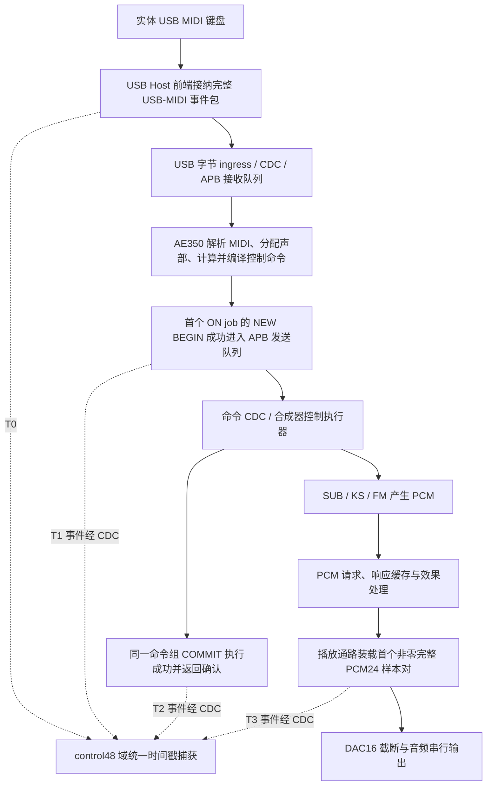

# AE350 三种合成器延迟测量原理与实现路径

编写日期：2026-11-04（JST）  
适用对象：独立实验工程 `ae350_midi_pcm_latency_lab_20261030` 当前 **T04 / AT04** 实现。  
测量目标：分别观察减法合成器 SUB、KS 物理建模合成器、FM 合成器，从 USB Note On 接纳到播放通路首个非零完整 PCM24 样本的响应，并分解接收处理、命令提交和输出等待。

本文依据当前 RTL、AE350 C 固件、串口解码器和已有验证记录编写。它是一份现有实现说明，不代表三种合成器的实板测量已经完成。工程仍独立于正在优化的主工程，尚未合入主工程。

**本次随包数据已按用户指定更新为 `uart.txt`：N20/N201，42 帧、20 个唯一编号、19 条有效、ID13 无效。数据示例和统计均以这份文件为准。它是此前计数÷2并重算 CRC 的离线派生文本，不能当作 T04/48MHz 新实测；正文 T04 实现原理与此 N201 数据的解析口径分别说明。**

## 1. 当前方案的基本原理

测量使用“**硬件锁存事件时间，AE350 保存记录并计算差值，电脑校验与统计**”的分工。

FPGA 内部有一个自由运行的 64 位计数器。在四个指定事件被观察到时，测量逻辑分别锁存计数值 T0、T1、T2、T3。四个时间戳使用同一计数器，因此可以直接相减。AE350 通过一个小型 APB 窗口取走已经冻结的快照，保存前 20 个输入编号对应的结果，计算四组计数差。控制事务空闲时，再把原始计数、差值、音符信息、PCM 样本和有效性标志经 UART 发给电脑。

**串口接收时间不参与延迟计算。** 即使一条记录晚几十毫秒才传到电脑，里面的时间戳仍然是此前硬件锁存的值。电脑看到的字符到达间隔，也不能代替被测事件间隔。

当前版本不再使用早期“FPGA 内部保存 20 行并负责格式化 N20”的实现。现在 FPGA 保留一条活动测量及一条保持稳定的结果 mailbox，20 行结果表和 UART 文本生成由 AE350 完成。

## 2. 实际信号路径

### 2.1 业务路径与四个测量点



图中 COMMIT 确认和 PCM 输出是从业务执行路径分别观察的两个事件。实现允许 T3 比 T2 更早被观察到，不把二者强行改成串行关系。

具体接线为：

1. `midi_host_frontend` 提供 `latency_usb_accept_o` 和原始 32 位 `latency_usb_packet_o`，经 `control_input_frontend` 接入 `synth_system`。
2. 业务 USB-MIDI 输入继续经既有 ingress、跨域队列和 APB 接收通路交给 AE350。
3. AE350 的原控制固件完成 MIDI 解析、路由、声部管理和控制命令编译，再通过 `control_link_apb` 提交命令。
4. `control_link_apb.latency_note_submit_o` 标记需要测量的首个 Note On 命令组 BEGIN；顶层从实际命令返回握手产生 COMMIT 成功事件。
5. `pcm_request_audio` 从真正用于播放的 PCM 样本对引出只读观测信号。
6. `ae350_latency_capture` 将这些事件整理成一条冻结的 18-word 原始快照，经 `held_bus_cdc` 送到 CPU 域。
7. `ae350_latency_apb` 暴露快照读取、POP 和 UART 单字节提交窗口。
8. AE350 的 `control_latency.c` 保存结果、计算差值、生成 AT04；电脑的 `read_ae350_t0t3.py` 校验并统计。

测量旁路不驱动 MIDI 或音频业务的 ready，不等待电脑，不控制 PCM 上传何时开始。

### 2.2 结果回传路径

```mermaid
flowchart LR
    A[FPGA 四时刻冻结快照<br/>18 × 32 bit] --> B[576 bit held-data CDC]
    B --> C[APB 诊断子页<br/>0xF8010100]
    C --> D[AE350 DTCM<br/>20 × 26 word]
    D --> E[空闲切片：CRC / 文本 / 单字节提交]
    E --> F[8 bit UART mailbox CDC]
    F --> G[midi_diag_tx<br/>200000 baud / 8N1]
    G --> H[原有 MIDI_DEBUG_TX 引脚]
    H --> I[电脑保存原始串口字节]
    I --> J[CRC / 计数差复核 / 分路统计 / 截图]
```



这里使用原有 FPGA 调试 TX。测试开启时由 T04 的字节发送器独占该输出；没有同时把旧诊断字符串混进同一根 TX。

## 3. T0、T1、T2、T3 的准确含义

| 时刻 | 当前硬件事件 | 已包含的处理 | 尚未包含或不能由此推断的内容 |
|---|---|---|---|
| T0 | USB Host 前端以 valid/ready 接纳完整 cable 0、CIN 9、velocity > 0 的 Note On 事件包，直接锁存 control48 计数 | FPGA USB 前端已经取得并接纳该逻辑事件包 | 键盘触点扫描、键盘内部处理、USB 总线包开始、主机发送时刻均不在起点定义内 |
| T1 | 当前音符首个 ON job 的 NEW BEGIN 成功进入真实 APB 发送队列，其事件在 control48 被观察到 | T0 后的 ingress、接收排队、AE350 解析、声部分配、计算、编译和首组 BEGIN 提交 | 不是 CPU 开始执行某条指令，也不是完整命令组执行完成 |
| T2 | 与该 BEGIN 身份一致的 COMMIT 在真实执行返回握手中成功，成功事件跨域后在 control48 被观察到 | 命令传递、队列/CDC、执行器处理及成功返回的观察路径 | 不是 COMMIT 刚入队，不是 C 程序稍后轮询到 ACK，也不等于首音已经输出 |
| T3 | 播放通路在 `frame_accept` 装载的首个完整 PCM24 样本对满足 `L != 0 || R != 0`，该事件在 control48 被观察到 | 到最终播放装载点为止的合成、PCM 请求响应、缓存、效果处理和帧调度 | 不是 native DSP 首样本、串行最后一位、模拟 DAC 输出、USB3 上传完成或电脑收到音频 |

### 3.1 T0 怎样识别一个有效 Note On

当前捕获条件对应 USB-MIDI 32 位事件包：

```text
byte0：0x09             cable 0 + CIN 9
byte1：0x9n             Note On，n 为 MIDI channel
byte2：0..127           note
byte3：1..127           velocity
```

只有符合上述格式且被 USB 前端实际接纳的事件才分配测量编号。velocity 为 0 的 Note On、Note Off、CC 等不分配新编号。它们如果出现在一条测量尚未完成时，可能破坏单音归因，因而仍会作为干扰使该条记录无效。

当前 T04 的正式起点只针对 **真实 USB cable 0 输入**。ESP RAW/web MIDI 不作为等价 T0 刺激；其他来源的非实时 MIDI 字节在活动测量期间作为干扰处理。MIDI realtime 字节 `0xF8..0xFF` 不按普通非实时消息取消归因。

最新源码已把 **32 位全零 USB transfer padding** 排除在干扰之外，与业务 ingress 忽略全零填充的规则一致。非零非法包、其他非实时消息的原有干扰检查仍保留。这个修复已有定向回归证据；尚未抓到本次实体键盘的 USB 原始 payload，不能把填充误判认定为此前所有实板无效记录的唯一原因。

### 3.2 T1/T2 怎样关联到同一条控制命令

事件中携带以下身份：

```text
engine + generation[31:0] + revision[31:0] + voice[4:0]
```

T1 来自 `BEGIN opcode = 0x10` 的真实成功提交；还要符合 ON job 的操作类别，SUB/FM 使用 NEW 0，KS 使用 ON 1。普通热更新、标量更新、释放和模板刷新不能冒充此 Note On 的首个 BEGIN。

T2 来自顶层实际返回条件：

```systemverilog
cmd_valid && cmd_ready && cmd_data[23:16] == 8'h13 && cmd_result == 0
```

捕获器要求 COMMIT 的 engine 和首次 BEGIN 的 generation/revision/voice 一致。错误身份会保留失败标志，不能拿别的命令确认补齐本条测量。

真实 SUB 路径可能在首组成功后继续提交同 voice、同 generation、较高 revision 的合法表达更新。因此实现允许这类后续组经过，但不覆盖首次 BEGIN、首次匹配 COMMIT 和已记录的 T3。这个关联属于命令身份校验；**当前 T04 没有把每个最终 PCM 样本与 MIDI note 做端到端 tag 匹配**。

### 3.3 首个非零 PCM 的判定

检测使用播放样本的完整有符号 24 位值：

```systemverilog
nonzero = (serial_left_i != 24'sd0 || serial_right_i != 24'sd0);
```

- 左、右任意一边非零即可，另一声道保持零合法。
- `+1`、`-1` 都触发，不设幅度门槛，不要求连续多个非零样本。
- 第一个符合条件的样本锁存后，不会被后来幅度更大的样本替换。
- 记录保存该时刻的原始 L24/R24，而不是只保存“触发了”这一结论。

检测点在 `pcm_request_audio` 的真正播放装载边界：它先按 epoch/sequence 匹配当前播放 pair，经过输出资格及静音选择，得到 `serial_left/right`，再由 `frame_accept` 装载。DAC 串行器使用的是这些样本的 `[23:8]`。因此例如 PCM24 的 `+1` 已经能触发 T3，截成 DAC16 后却仍可能为 0；不能用这类 T3 直接断言模拟端已有可听声音。

PCM 资格至少要求 `play_found=1`、`testtone=0`，并且 engine 与本条测量一致。测试音、错误播放 pair 或错误 engine 的非零值不能成为有效结果。质量字的其他状态位会随生产状态变化，不能错误地要求质量字等于某个固定常量。

## 4. 同一时基、原始计数与换算

### 4.1 T04 使用什么时钟

当前 T04 捕获器接 `synth_system.control_clk`，按现有实现及协议定义为 **48,000,000 Hz 的 control48 时基**：

```text
ae350_latency_capture.CLK_HZ       = 48,000,000
control_latency.h CL_CLOCK_HZ     = 48,000,000
AT04 word15                      = 48,000,000
```

四个时刻都在这个域锁存同一条 64 位 `tick`，每个计数周期增加 1。它不是 AE350 core 的指令周期计数器，也不是 UART 位时钟。

按协议时基：

```text
1 tick = 1 / 48,000,000 s = 20.833333... ns
时间(us) = 计数差 / 48
时间(ms) = 计数差 / 48,000
```

这些是当前代码与协议的换算定义，不是本次文档工作重新校准了实板晶振。此前用户指定 100 MHz 对旧 N201 记录进行的离线换算，以及另存的“计数÷2并重算 CRC”文本，均应按其独立处理条件理解，不能覆盖本 T04 的 48 MHz 计数定义或冒充新收到的原始帧。

### 4.2 原始 64 位计数怎样保存

每个时刻由两个 32 位 word 组成，**低 32 位 word 在前，高 32 位 word 在后**：

```text
T0 = word4  | (uint64(word5)  << 32)
T1 = word6  | (uint64(word7)  << 32)
T2 = word8  | (uint64(word9)  << 32)
T3 = word10 | (uint64(word11) << 32)
```

这些计数是从捕获器复位后起算的绝对 tick，不是各段延迟。它们可以超过 32 位；只截取低 word 会在低 32 位进位时算错。

presence 位表示某个时刻是否实际取得。**tick 恰好为 0 可以是合法时刻；缺失字段的原始 0 不能解释成“测得零延迟”。** 解码后缺失的语义时间戳使用 `null`。

### 4.3 四组差值分别说明什么

| 差值 | 当前电脑字段名 | 合理解释 |
|---|---|---|
| T1−T0 | `receive_queue_and_ae350` | USB 逻辑接纳后的接收/排队，加 AE350 解析、分配、计算、编译，直到首组 BEGIN 成功提交的响应 |
| T2−T1 | `command_transfer_and_commit` | 首组 BEGIN 提交后，命令链路、执行及匹配 COMMIT 成功返回的响应 |
| T3−T2 | `synthesis_and_output_wait` | COMMIT 返回观察点与首个非零播放样本观察点之间的时间关系；可以为负 |
| T3−T0 | `usb_note_on_to_pcm` | 本方案的总响应：USB Note On 逻辑接纳到首个非零完整 PCM24 播放装载 |

对字段齐全的记录，四段关系应满足：

```text
(T1−T0) + (T2−T1) + (T3−T2) = T3−T0
```

AE350 以无符号 64 位减法保存模 `2^64` 的原始结果；电脑复算相同差值，再按有符号 64 位解释。因此正常短时间窗口跨过计数回绕仍可正确表达，负差值也不会被当作极大的正延迟。

T3 可能先于匹配 COMMIT 返回被观察到，此时保留负的 T3−T2，不截成 0，也不换用 COMMIT 入队时刻。T3 早于首次 BEGIN 则无法归因给这条命令，应判无效。成功记录还要求 T0→T1、T1→T2、T1→T3、T0→T3 满足当前 1 秒测量窗口内的因果顺序。

**不能把 T1−T0 称为 AE350 纯指令耗时或 WCET。** 当前没有测定 AE350 每条指令的周期，也没有从这个区间扣除接收队列、APB 和协作式调度等待。host C 仿真同样不提供真实 AE350 指令时序模型。

## 5. 跨时钟域怎样观察事件

T0 在 control48 内直接捕获；T1/T2 原始事件在 CPU/APB 域，T3 在 audio 域。实现不是把三个域各自的自由计数直接相减，而是把事件及其完整 payload 可靠传到 control48，在目的域观察到事件时锁存公共 tick。

| 传递内容 | 当前模块/宽度 | 作用 |
|---|---|---|
| BEGIN 身份 | `u_begin`，71 bit | 69 位 generation/revision/voice + 2 位 engine |
| COMMIT 成功身份 | `u_ack`，71 bit | 保持同一组身份随成功事件一起跨域 |
| 播放样本 | `u_audio`，59 bit | L24、R24、engine2、quality8、静音资格1 |
| 冻结结果 | `u_result`，576 bit | 18 个原始 word 整体保持到 CPU 取走 |
| UART 字节 | `u_uart_cdc`，8 bit | APB 提交到实际 UART 发送时钟域 |

`midi_pcm_latency_event` 使用源端保持数据、request/ack 握手和同步器；忙时无法接纳新事件会留下 loss。`held_bus_cdc` 同样保持整个 payload，跨域同步的是握手控制，不能把多位数据简单逐位打两拍后拼起来。CPU 侧结果在成功 POP 前保持不变，避免分 18 次读取时撕裂。

代价是 **T1/T2/T3 含有事件跨域和目的域观察延迟**。已有功能相位检查观察到正常约 3–4 个 control48 周期的相关观察开销，但这个范围不能当成每条实板记录的固定补偿，当前也没有从数据中减掉它。20.833 ns 是计数分辨率，不能据此声称绝对测量精度达到 20.833 ns。

源域复位/失活、事件 mailbox 丢失等会取消有效归因。SDC 检查还覆盖同步首级 D 和保持数据总线的实际对象；静态对象命中通过不等于整个实现的 STA 已闭合。

## 6. 前 20 条、静音资格和异常处理

### 6.1 “前 20 条”怎样编号

符合输入格式的 USB Note On 按接纳顺序编号 1..20。**这是前 20 条输入事件，不是反复补采到 20 条成功记录。** 非静音、超时等失败样本仍占用原编号，保存失败原因；不能删掉后重新编号。

当前硬件是小缓冲结构：一条活动测量加一条冻结结果 mailbox。AE350 及时搬走快照后，后续独立音符才有空间继续测量。如果输入过快，导致活动测量重叠或结果搬运不及，硬件仍推进输入编号并设置 sticky loss，可能出现未保存编号的缺口。电脑应报告缺项/失败，不能把后来的音符偷换成丢失的前 20 条。

第 21 条不覆盖已完成记录；但若它在第 20 条仍未取得终点时到达，会破坏第 20 条的归因并留下 overlap/loss 无效标志。20 条完成后，继续弹奏属于本批之外。

### 6.2 测量前为什么要求静音

要把“首个非零样本”尽量归因于新音符，开始前要求目标 engine 已有 **连续 256 个有效且精确为双零的播放帧**。计数的是播放帧，不是 256 个 control48 周期。

判断静音使用同一完整 PCM24 数据。任一声道非零、播放 pair 无效或 testtone 会打断静音累计。选路改变或域失活也会撤销已经确认的静音资格。256 帧对应的实际时间取决于播放采样率，例如只有在 96 kHz 时才等于约 2.667 ms；执行板测时不能拿这个条件替代对前一音尾音完全结束的确认。

如果 Note On 到来时尚不满足静音条件，仍记录该输入编号并标记 `notquiet/invalid`。本实现不缓存整段 PCM 去做多音分离，因此实际测试应固定音色/包络和路由，先释放前一个音，等到完整 PCM 精确归零后再触发下一次。

### 6.3 哪些情况会使记录无效

| 情况 | 处理原则 |
|---|---|
| 前一音未归零或同 tick 有无法归因的起音 | 标记非静音/无效，保留原编号 |
| 活动测量期间又来 Note On | 重叠/丢失，不能归因于单个音符 |
| 其他非实时 MIDI、engine 切换、flush、相关域失活 | 冻结为干扰/路由类无效 |
| BEGIN/ACK/audio 事件 mailbox loss | 设置 sticky loss，后续不能假装整批无丢失 |
| COMMIT 的 generation/revision/voice 错配 | 身份错误，不能用其它事务补齐 |
| 非零 PCM 先于该音符的首次 BEGIN | 保留所见原始时刻，但不能成为成功记录 |
| 非零 PCM 来自错误 engine、无效 pair 或 testtone | PCM 质量无效 |
| T0 后 48,000,000 tick 仍未完成 | 约 1 秒超时，冻结并保留已取得的时刻 |

所有 T0/T1/T2/T3 均取得后可以冻结；先取得 T3 时仍可等待稍后的匹配 T2。冻结后的时刻和样本不被较晚事件覆盖。

### 6.4 为什么三种合成器分成三批

engine 编码为 `0=SUB`、`1=KS`、`2=FM`。同一批应固定一种 engine，避免选路改变和其它音尾混入。电脑按记录里的 engine 核对请求目标，混合 engine 的批次不能 PASS。

硬件与 AE350 当前共同使用全局前 20 条状态，没有 UART rearm 命令；切换合成器本身不会清空前 20 条。三路应分别使用新测量实例/完整复位后的独立批次，每批保留原始字节、计数、标志、有效数和统计。现有三颗按键用于菜单选路，不能当作测量复位键。

## 7. FPGA 与 AE350 的职责和缓冲规模

### 7.1 FPGA 只负责必要的及时捕获

`ae350_latency_capture` 负责 tick、输入编号、一条活动记录、静音/身份/异常判定及结果发布。它不负责 20 组完整 UART 字符串，不保存连续 PCM 音频，也不阻塞业务来等待结果上传。

`ae350_latency_apb` 提供一个独立诊断子页，不修改原控制 ABI 的既有偏移：

| 绝对地址 | 相对子页偏移 | 含义 |
|---|---|---|
| `0xF8010100` | `0x00` | ID：`0x4c543034`，表示 LT04 |
| `0xF8010104` | `0x04` | status：bit0 结果 valid，bit1 可提交 UART 字节，bit2 sticky loss |
| `0xF8010108` | `0x08` | 写 1 POP，确认取走当前冻结结果 |
| `0xF801010C` | `0x0C` | 写一个 UART 字节，高 24 位必须为 0 |
| `0xF8010110` | `0x10` | 计数频率：48,000,000 |
| `0xF8010120..0xF8010164` | `0x20..0x64` | 18 个只读原始快照 word |

未对齐、未知地址、非法 strobe、没有 valid 时读快照、没有 ready 时提交字节等返回 APB 错误；非法访问不应产生 POP/TX 等副作用。

### 7.2 AE350 保存和计算什么

`cl_state_t.rows[20][26]` 保存结果表，本身大小为 **2,080 B**；另有 18-word 临时快照 **72 B**、CRC 和少量状态。整个模块不等于只有 2,080 B，但没有堆分配，也没有新增连续 PCM 缓冲。

18 个硬件 word 原样保存；后 8 个 word 是四组 64 位差值。AE350 不覆盖原始时间戳，不用浮点或 64 位除法计算微秒平均。换算与平均在电脑端进行。

### 7.3 “空闲 UART”怎样执行

主循环先运行 `cs_poll()` 处理 MIDI 和控制，再调用：

```c
cl_poll(&latency, !work && cs_diagnostics_idle(&controls), now);
```

正常运行时，空闲条件不仅是 CPU 当前没有在发字符，还包括：控制服务正常运行且 ready，没有待处理 MIDI/parser 事件、命令/ACK、编译刷新、模板、路由、flush、恢复或相关硬件队列待办。控制服务已经进入 `fatal && CS_FAILED` 终态时，也允许有界排空诊断；这不会清除故障或自动重试控制事务。

每次 `cl_poll()`：

1. 即使控制忙，也至多读取一个原始快照 word；18 个 word 收齐时保存记录、执行四次 64 位减法并 POP。
2. 只有空闲分支才进行 CRC/文本输出工作；CRC 按单个 word 分切片计算。
3. 每次至多提交一个 UART 字节；not ready 就返回，不忙等。
4. 新控制事务在下一次主循环优先处理。已在硬件里开始发送的字节会正常发送完；未提交的后续字节可以暂停，因此一行内部的字节之间也允许暂停。

因此准确表述是“**CRC、格式化及新 UART 字节提交只在控制空闲切片执行**”，不是所有诊断读数和减法都必须等空闲。测量旁路和固件轮询仍有少量资源/执行开销，当前没有把它证明为零扰动。

某条完整记录可以在其测量完成且控制空闲后回传，不必等全部 20 条，也不必等 PCM 传输完成。全 20 条均保存并发送完后，至少距末条发送完成 1 秒，才在后续空闲切片重放整批；这不是固定周期保证。重复帧便于复核，不能在统计中重复计入。

## 8. 原始 AT04 串口协议

### 8.1 一行的外层格式

```text
AT04 <word0..word25 连续 208 个十六进制字符> <4 个 CRC 十六进制字符>\r\n
```

每个 word 固定 8 个十六进制字符，word 序为 0→25，每个 word 内从高 nibble 到低 nibble 显示。正常固件输出小写 hex，解码器也接受大写 hex；中间没有逐 word 分隔空格。

一条正常帧固定：`5 + 208 + 1 + 4 + 2 = 220 B`。

### 8.2 26 个 word 的定义

| word | 内容 |
|---|---|
| 0 | 签名 `0x4c543034`（LT04） |
| 1 | 原始输入编号 ID，1..20 |
| 2 | metadata：bits1:0 engine；5:2 channel；12:6 note；19:13 velocity；31:20 保留为 0 |
| 3 | flags |
| 4、5 | T0 的低/高 32 位 |
| 6、7 | T1 的低/高 32 位 |
| 8、9 | T2 的低/高 32 位 |
| 10、11 | T3 的低/高 32 位 |
| 12 | 首组 revision |
| 13 | 首组 generation |
| 14 | voice，低 5 位有效，高 27 位为 0 |
| 15 | `48,000,000` 计数 Hz |
| 16 | `{原始 L24, 8'b0}`，左对齐有符号 PCM24 |
| 17 | `{原始 R24, 8'b0}`，左对齐有符号 PCM24 |
| 18、19 | AE350 计算的 T1−T0，低/高 32 位 |
| 20、21 | AE350 计算的 T2−T1，低/高 32 位 |
| 22、23 | AE350 计算的 T3−T2，低/高 32 位 |
| 24、25 | AE350 计算的 T3−T0，低/高 32 位 |

若一组差值所需的任意时间戳未取得，该差值 word 为 0，同时通过 presence/invalid 表达缺失，电脑显示为未取得，不当作零延迟。

### 8.3 flags

| bit | 名称/含义 |
|---|---|
| 0 | T0 已取得 |
| 1 | T1 已取得 |
| 2 | T2 已取得 |
| 3 | T3 已取得 |
| 4 | frozen，结果冻结 |
| 5 | timeout |
| 6 | invalid |
| 7 | notquiet |
| 8 | overlap |
| 9 | observation loss |
| 10 | route / flush / reset / interference 类取消 |
| 11 | command identity 错误或无法归因的时序 |
| 12 | PCM quality / engine 错误 |
| 31:13 | 保留，必须为 0 |

完整成功记录的 flags 恰为 **`0x0000001f`**，还需通过解码器的因果顺序、时间窗、身份范围、PCM、差值一致性和 CRC 检查。仅 CRC 正确不等于测量成功。

### 8.4 CRC 与诊断帧

CRC 使用 CRC16/CCITT-FALSE：初值 `0xffff`、多项式 `0x1021`。CRC 输入是 26 个 word **各自按低字节在前打包**得到的 104 个原始二进制字节，不是页面上 208 个 ASCII hex 字符。

固件还可能发：

```text
AT4E <8hex faultmask> <4hex CRC16>\r\n
```

诊断帧固定 20 B，faultmask 的 IO / protocol / loss / conflict 位分别为 1 / 2 / 4 / 8。CRC 对 faultmask 的 4 个小端字节计算。收到 AT4E 要保留原文并把整流标为失败，不能改写成正常样本；已开始的一行先发完，再输出诊断，避免故障消息插入半行。

### 8.5 200k 串口是否影响测量

当前 UART 配置为 **200000 baud、8N1**。一字节在线上需要 10 bit：

```text
单条 220 B 的理想连续线速时间 = 220 × 10 / 200,000 = 11 ms
20 条共 4,400 B 的理想连续线速时间 = 220 ms
```

实际采用 CPU 空闲切片发送，允许字节间暂停，因此实际收完整行/批次可更慢。11 ms/220 ms 是串口线速计算值，不是合成器延迟，不添加到 T3−T0，也不是实际完成回传时间的保证。

## 9. 原始数据、有效平均与截图如何对应

本节前半说明当前 **T04/48MHz** 规则；本次随包 `uart.txt` 是 **N201/50MHz**，其专用解码器、原计数和最新统计见 **9.1**，不能套用下方 T04 的除48换算。

电脑端以保存下来的原始字节为准，通过 `scripts/read_ae350_t0t3.py` 离线解码。它不向 FPGA 发命令，不改原始帧。

需要保留三层证据：

| 层 | 应保存的内容 | 用途 |
|---|---|---|
| 原始串口 | BIN/TXT 原字节、CRLF、重复帧、诊断帧、坏帧和截断片段；记录 SHA256 | 证明设备实际发了什么，便于重新解码 |
| 原始计数 | 全部 26 个 word、四个 uint64 tick、flags、engine、channel/note/velocity、identity、L/R PCM24 | 复查测量边界和数值，不能只留换算后的平均 |
| 派生结果 | 四组差值、微秒换算、每 engine 有效数/缺项/无效数、均值和范围 | 分析系统响应；必须能回溯原始帧 |

相同 ID、相同所有原始 word 的重放只计一次；相同 ID 却内容改变则是冲突错误。混入旧 N20 帧、CRC 错误、格式错、尾行截断或 AT4E 都不能被静默过滤后宣称完整流 PASS。

平均值只取 `successful` 的记录。解码器以原始整数计数及分数方式累计，再换算：

```text
平均计数 = Σ有效记录的差值 / 有效记录数
平均微秒 = 平均计数 / 48
```

没有有效记录时平均为 `null`，不能写 0。存在无效/缺项/整流错误时，即使有部分有效数据可供故障参考，也要同时标明批次不完整或失败。完整单 engine 批次 PASS 要求 ID1..20 齐全、20 条全有效、没有流错误或混路。

截图分别展示：

1. **原始计数**：T0/T1/T2/T3 的完整整数、ID、engine、flags，不用只有小数毫秒的统计表替代。
2. **原始串口**：接收原文，包括实际帧头、hex 和 CRC；截图只是可见部分，原文件负责保存全部字节。
3. **统计状态**：样本数、有效数、缺项、平均和失败原因，避免截图看起来像已通过但实际没有有效样本。

对旧数据改时钟换算或按要求加工计数时，必须另存派生文件并标明加工条件。即使重新计算 CRC 后格式正确，也不能再称那份加工文本为原始接收数据。

### 9.1 本次最新文件与计数示例

本次使用用户指定的 [uart.txt](../../sim/results/uart_half_counts_20261104/20261104T024956Z/uart.txt)，文件保持原字节，共 **11,214 B / 42 条完整 N20 帧**。逐帧 CRC/格式通过；ID1..20 齐全，22 条相同重放，19 条有效，ID13 无效。有效记录均为 RAW1→SUB；KS、FM 在这份文件中没有有效样本。

文件签名为 **N201**，沿用 `abs(PCM16)>1` 终点，包内频率字段为 **50,000,000 Hz**。原始 M0/M1/PCM 及 timeout 曾按整数÷2处理并重算 CRC，当前文件 SHA 与此前派生导出相同；本次加入压缩包没有再次改计数。它不是新的 AT04 四时刻采集，不使用正文 T04 的48MHz换算，也不能改名成 T0/T1/T2/T3。

以下是文件中 ID1 的原计数：

| 字段 | 实际值 | 解释 |
|---|---|---|
| ID / source / engine / note / velocity | 1 / RAW1 / SUB / 60 / 64 | 本文件对应记录 |
| flags | `0x00000303` | N201 有效记录，按 N201 flags 解释 |
| M0 | **5,129,280,866** | 首输入观察计数 |
| M1 | **5,129,334,039** | 完整 Note On 观察计数 |
| PCM | **5,129,596,532** | N201 阈值终点观察计数 |
| PCM−M1 | **262,493 tick = 5.24986 ms** | 按文件50MHz换算 |

本文件19条有效记录的均值为：

| 区间 | 均值 | 说明 |
|---|---|---|
| M0→M1 | **1.837270526 ms** | 输入组装/观察区间，不是CPU纯处理时间 |
| M1→PCM | **5.016738947 ms** | 完整消息到N201阈值终点 |
| M0→PCM | **6.854009474 ms** | 本文件计数对应的总区间 |

原计数先逐条做差，再按19条精确累计。减半时向下取整会使个别tick不同于“把旧浮点均值直接除2”，因此这里以当前 `uart.txt` 重新计算的结果为准。ID13保留在文件/计数表中，但不参与有效平均。

本次代码包中的 `latest_data/` 提供原文副本、解码JSON、原计数CSV和来源说明；不沿用此前其它数据的截图作为本文件截图。

## 10. 与原 PCM 测量/USB3 通路的关系

本功能的回传内容是 **时间戳与少量诊断元数据**，采用 UART。它没有新增连续 PCM 上传协议，没有要求先完成测量才能开始 PCM 传输，也没有改造 CH569/USB3 桥接固件。

当前独立工程取自较早快照；正在优化的主工程中，原有 PCM 监测/上传通路及后续优化仍是另一条业务。本文所述测试旁路只观察播放样本，不能将其等同于主工程 PCM 上传链路的验收。以后若合入，必须基于主工程当时实际版本应用最小改动，不能用整个旧快照覆盖主工程。

T3 截止于 FPGA 内部播放装载点，因此不会测到 HSPI/USB3 包传输、桥接、主机驱动或电脑音频软件缓存。若需要这些区间，需另有对应边界和统一时基证据，不能从本批四个时间戳反推。

## 11. 顶层综合开关与版本区分

通用顶层 `control_lab_top` 默认：

```systemverilog
ENABLE_MIDI_NOTE20_TEST = 1'b0
```

专用实验包装顶层 `midi_pcm_latency_lab_top` 默认开启该参数，并设置 `DEBUG_UART_BAUD=200000`；旧 `ENABLE_MIDI_PCM_LATENCY_TEST` 单次 LAT1 observer 关闭。必要的 APB/PCM 只读事件输出由两种测试使能的并集启用，确保新 T04 能看到真实 BEGIN 与播放样本。

gate 关闭时，T04 捕获路径不实例化、结果输出为常量；诊断子页 ID 读 0，公共固件探测后禁用 T04，UART 走正常分支。专用测试 SDC 对应其启用的层级，不能仅关闭参数却沿用不再存在对象的约束来构建。

| 版本 | 主要口径/结构 | 当前应怎样使用 |
|---|---|---|
| LAT1 | 旧单次 probe，独立格式和边界 | 历史参考，不能用其 reader 解析当前帧 |
| N201 | N20 硬件 20 行，旧 `abs(PCM16)>1` 阈值 | 本次 `uart.txt` 按此版本解析；19有效/ID13无效，计数已离线减半 |
| N202 | N20 改成完整 PCM24 非零终点 | 阈值口径更新，仍不是当前 T04 架构 |
| N203 | N20 扩展分段字段 | 历史阶段实现，后由 CPU 持表方案替换 |
| **T04 / AT04** | 四点 control48 捕获；AE350 20 行保存、差值和空闲 UART；220 B/行 | **本文正文适用的当前方案** |

旧 N201 中的 M0/M1/PCM 不能直接改名成 T0/T1/T2/T3。历史 SUB 均值，以及按用户指定 100 MHz 得到的旧记录离线换算，不是当前 T04 的三路实测结果。

## 12. 当前代码验证与最新数据状态

当前测量代码仍为 T04。功能证据包括 capture 1,209 checks/86场景、APB/UART 12,007 checks、C 100,113 checks、Python AT04 27项、三DSP真实C功能闭环，以及USB全零padding修复364 checks/24场景。它们说明代码功能覆盖，不能代替CPU指令周期、STA或实板精度验收。

截至2026-11-04 12:12 JST保存的构建交付记录，padding修复综合验收通过，PnR队列WAITING；没有据此产生新的T04三路有效测量结论。既有普通setup/capture等STA负余量限制仍需相应实现验收，不能以数据CRC通过代替。

**本次交付的数据状态以用户指定 `uart.txt` 为准：**

| 项目 | 最新文件结果 |
|---|---|
| 格式/版本 | N20 / N201，不是AT04 |
| 原文大小/完整帧 | 11,214 B / 42帧 |
| 唯一ID/相同重放 | 20 / 22 |
| CRC/格式/冲突 | 全通过 / 无冲突 |
| 有效/无效 | 19 / 1，ID13无效 |
| 有效engine | SUB；KS/FM无有效数据 |
| M1→PCM平均 | 5.016738947 ms，按文件50MHz和当前计数 |
| M0→PCM平均 | 6.854009474 ms，按文件50MHz和当前计数 |
| 数据来源 | 先前计数÷2并重算CRC的导出，本次原字节加入 |

因此可以复核这份N201派生文件中的SUB统计，但不能称为三种合成器已全部测完，也不能称为当前T04“首个非零完整PCM24”口径的实板均值。

## 13. 复核源码与证据索引

以下链接相对本文件所在目录。行号用于定位本次阅读的当前源码，后续修改时需重新核对。

| 内容 | 文件与本次定位 |
|---|---|
| 实验顶层与参数 | [midi_pcm_latency_lab_top.sv](../../rtl/midi_pcm_latency_lab_top.sv)，第 1–22 行 |
| 通用顶层、T04 APB/UART、真实 ACK 接线 | [control_lab_top.sv](../../rtl/control_lab_top.sv)，第 1–5、99–117、214–250 行 |
| 实际四点捕获器 | [ae350_latency_capture.sv](../../rtl/ae350_latency_capture.sv)，第 7–73、97–195 行 |
| USB 前端接纳事件 | [midi_host_frontend.sv](../../src/control_input/usb_midi/midi_host_frontend.sv)，第 147 行附近 |
| T04 在业务系统中的接入 | [synth_system.sv](../../src/board/synth_system.sv)，第 430–458、500–529 行 |
| 首个 ON BEGIN 打点/身份 | [control_link_apb.sv](../../control_migration/rtl/control_link_apb.sv)，第 137–150 行 |
| 真正播放 PCM24 与 DAC16 截断 | [pcm_request_audio.sv](../../src/pcm_post/pipeline/pcm_request_audio.sv)，第 96–131 行 |
| 单槽 held-data 跨域握手 | [held_bus_cdc.sv](../../src/common/cdc/held_bus_cdc.sv)，第 1–18、92–134 行；事件封装见 [midi_pcm_latency_probe.sv](../../rtl/midi_pcm_latency_probe.sv) 中的 `midi_pcm_latency_event` |
| 诊断 APB 寄存器和 UART 字节 CDC | [ae350_latency_apb.sv](../../rtl/ae350_latency_apb.sv)，第 23–65 行 |
| AE350 20 行状态/频率/帧长度 | [control_latency.h](../../firmware/control_latency.h)，第 6–41 行 |
| AE350 差值、保存、CRC、空闲发送 | [control_latency.c](../../firmware/control_latency.c)，第 27–74、79–149 行 |
| 业务优先、idle 接入 | [control_main.c](../../firmware/control_main.c)，第 62–79 行；[control_service.c](../../firmware/control_service.c)，第 37–59 行 |
| 电脑端严格解码与统计 | [read_ae350_t0t3.py](../../scripts/read_ae350_t0t3.py)，第 52–133、150–234 行 |
| 本次最新数据原文 | [uart.txt](../../sim/results/uart_half_counts_20261104/20261104T024956Z/uart.txt) |
| N201/N202/N203 数据解码 | [read_note20_uart.py](../../scripts/read_note20_uart.py)；本次N201采用此脚本 |

当前T04帧应使用AT04专用解码器。**本次 `uart.txt` 是N201，必须使用 `scripts/read_note20_uart.py --input <uart.txt> --output <新JSON>`，不能交给AT04解码器。** 下方命令仅用于日后取得的真正AT04帧；输出应另存：

```bash
python3 -B scripts/read_ae350_t0t3.py \
  --input '<本批原始UART文件>' \
  --output '<另存的解码JSON>' \
  --engine SUB
```

这一步只复核已有字节。它不能生成缺失的时间戳、补齐未测的音符，或把无效记录变成有效板测。
