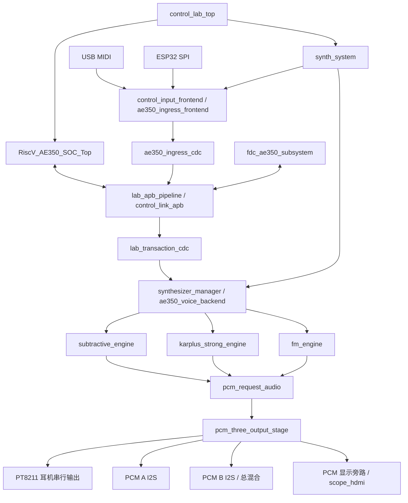
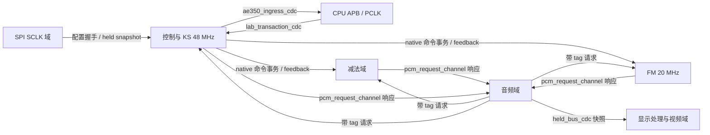

# FPGA 架构

本文说明空灵云音当前 FPGA 源码的实际组织、控制权和音频数据流。依据是 [Gowin 工程清单](../fpga/ethereal_cloud_tone.gprj)、[构建入口](../fpga/scripts/run_control_project.tcl) 与当前 RTL，入口顶层为 [`control_lab_top`](../fpga/rtl/top/control_lab_top.sv)，器件为 `GW5AST-LV138PG484AC1/I0`，数据库 `gw5ast138c-007`。

当前清单有 278 项文件、276 项启用；这是编译文件集合，具体硬件分支仍由顶层参数和 `generate` 决定。本文依据当前顶层默认值及其向下传参，不将子模块为兼容其它顶层而设置的默认值当作主工程配置。本文是源码架构说明；实际构建、软件专项、时序和硬件验收见 [验证记录](VALIDATION.md)。

## 系统分工

AE350 负责 MIDI 解析、声部和参数编译，FPGA 各声音后端负责确定性的运算与采样响应，音频域统一拥有物理输出帧。ESP32 通过 SPI 提交控制、音色模板和原始 MIDI；USB MIDI 由 FPGA 输入前端接收。主工程包含三条完整声音路线：**减法合成器、KS 物理建模、FM**。DDS 是减法路线中的振荡器技术，同时也用于部分辅助波形，不能用来命名整套三引擎系统。

图中音频箭头表示带请求标签的响应数据流；采样请求由 `pcm_request_audio` 反向送往每个引擎。各路径还带有 ready、反馈、故障和复位信号，不能将图中的单箭头理解成无背压直连。

## 顶层与控制通路

[`control_lab_top`](../fpga/rtl/top/control_lab_top.sv) 直接实例化 CPU 生成 IP、核心 PLL、APB 请求/响应寄存级、调试观察、控制寄存器和 FDC 子系统，再用 `u_system: synth_system` 连接音频系统。它将 CPU 的菜单/发布服务与声音控制页分开；FDC 页单独解码在 `F8010100..F801017F`。[`lab_apb_pipeline`](../fpga/rtl/top/lab_apb_pipeline.sv) 捕获请求并寄存响应，避免将实时 CPU 地址和完整控制读回组合逻辑直接接到硬核端口。

1. [`control_input_frontend`](../fpga/rtl/control_input/control_input_frontend.sv) 汇集 USB MIDI 与 SPI 控制入口；SPI 同时服务配置写入、状态读取和原始 MIDI 邮箱。
2. [`ae350_ingress_frontend`](../fpga/rtl/ae350/ae350_ingress_frontend.sv) 在控制域整理字节、来源、时间戳及 flush。当前 AE350 分支不使用旧的本地 `midi_decoder` 作为声音控制所有者。
3. [`ae350_ingress_cdc`](../fpga/rtl/ae350/ae350_ingress_cdc.sv) 将输入送至 CPU 的 PCLK 域。顶层 [`control_link_apb`](../fpga/rtl/ae350/control_link_apb.sv) 配置接收深度 32、发送深度 4、反馈深度 16；flush 完成、模板状态和后台状态有各自回传。
4. CPU 源码位于 [`firmware/ae350`](../fpga/firmware/ae350/)。[`control_service.c`](../fpga/firmware/ae350/app/control_service.c)、[`control_compile.c`](../fpga/firmware/ae350/app/control_compile.c) 与 MIDI 运行时把控制请求编译为后端事务，而不是由软件逐个计算音频样本。
5. [`lab_transaction_cdc`](../fpga/rtl/top/lab_transaction_cdc.sv) 将事务及结果跨域。`synthesizer_manager` 内的 [`ae350_voice_backend`](../fpga/rtl/ae350/ae350_voice_backend.sv) 做准入与三路分发，各 native 后端按自身时钟执行，声部 generation 等反馈返回 CPU。

[`fdc_ae350_subsystem`](../fpga/rtl/fdc2214/fdc_ae350_subsystem.sv) 是当前顶层的传感器采集与 APB 入口。AE350 模式下，`synth_system` 关闭输入前端内的旧传感器映射分支，避免出现第二个 I2C 主控/参数所有者。顶层的传感器状态和遥测以独立 CDC 发布到 SPI；状态可观察性与实际 native 参数采用是不同阶段。

## 三条声音路线

| 路线 | 当前实现入口 | 计算与状态的边界 |
| --- | --- | --- |
| 减法合成器 | [`subtractive_engine`](../fpga/rtl/synthesizers/subtractive/subtractive_engine.sv) → [`element_pipeline`](../fpga/rtl/synthesizers/subtractive/dsp/element_pipeline.sv) | 256 个 element 的时分流水线；`element_param_bank` 保存参数，`element_state_store` 保存跨采样状态，`csp` 处理控制/调制，`element_renderer` 串接振荡器、滤波和增益等计算。AE350 native 写入与旧事件接口由编译参数区分。 |
| KS 物理建模 | [`karplus_strong_engine`](../fpga/rtl/synthesizers/karplus_strong/karplus_strong_engine.sv) → [`physical_model_top`](../fpga/rtl/synthesizers/karplus_strong/dsp/physical_model_top.sv) | 当前核心默认 `VOICES=16`，含延迟环与反馈状态；native 控制由 `ae350_voice_backend_ks` 接入，KS 动态限幅开启。当前 `ENABLE_KS_TIMBRES=0`，不能把扩展音色模型接口的存在写成已启用。 |
| FM | [`fm_engine`](../fpga/rtl/synthesizers/fm/fm_engine.sv) → [`jt51_prepared_audio_backend`](../fpga/rtl/synthesizers/fm/audio/jt51_prepared_audio_backend.sv) | 当前 AE350 分支使用 `ae350_voice_backend_fm`、`jt51_native32_top` 与 `jt51_register_writer32`。每个带标签的 PCM 请求触发 128 槽 operator 工作；MIDI/音色/operator 参数编译保留在 CPU 侧。不能仅因工程包含上游 JT51 顶层，就将现行路径描述为直接实例化传统单个 JT51。 |

[`synthesizer_manager`](../fpga/rtl/synthesizers/synthesizer_manager.sv) 是三条路线的集成层，负责 native 控制分发、后端 ready/fault/feedback、请求驱动调度与配置视图。当前 `PCM_REQUEST_DRIVEN=1`、`CONTROL_CLOCK_SPLIT=1`；引擎运算速度和最终串行输出帧率是两个概念，前者由各 native 时钟和调度器决定，后者由音频输出域决定。

减法路线的 `boot_p0..p3.hex`、振荡器/滤波系数 LUT 是实际初始化输入，不是可丢弃的仿真文件。其路径从 `fpga/` 工程根解析；构建入口会切换至该目录。

## PCM 请求、效果与三个物理输出

[`pcm_request_audio`](../fpga/rtl/pcm_post/pipeline/pcm_request_audio.sv) 在音频域统一发出帧请求。三个 [`pcm_request_channel`](../fpga/rtl/pcm_post/pipeline/pcm_request_channel.sv) 分别跨到减法、KS、FM 域，携带 64 位 tag 并带回同 tag 的左右 24 位 PCM。主顶层开启 AE350 控制，因而 `PARALLEL_SOURCES=1`，走 [`pcm_three_output_stage`](../fpga/rtl/pcm_post/pipeline/pcm_three_output_stage.sv) 三路并行分支。

该分支按同一 tag 对齐三个源；缺失源在相应帧贡献零，不回放上一帧。三路原始样本保留为独立 tap，总混合走一套 [`pcm_frame_effect`](../fpga/rtl/pcm_post/pipeline/pcm_frame_effect.sv) 效果 worker。源码对原始和保留单位增益、取低 24 位，没有新增自动归一化器；这描述的是实现行为，不是最大电平或听感验收。

| 输出 | 数据选择与串行格式 |
| --- | --- |
| `HP_*` | `output_routes[1:0]` 选择 SUB / KS / FM / 总混合，`pt8211_tx` 发送每声道 16 位。 |
| `PCM_*`，即 PCM A | `output_routes[3:2]` 选择同四类数据，`i2s_tx` 发送每声道 24 位。 |
| `PCM_B_*` | 固定取效果后的总混合，每声道 24 位 I2S；顶层将它的 BCK、WS、MCK 与 PCM A 共用。 |

[`pcm_output_routes`](../fpga/rtl/pcm_post/pipeline/pcm_output_routes.sv) 在音频帧边界原子采用路由请求，复位值 `4'h4` 对应耳机 SUB、PCM A 为 KS；PCM B 仍是总混合。PT8211 发射器是请求帧基准，两条 I2S 发射器与它共享音频时钟、复位及 256 个音频时钟/帧的节拍。`PCM_MCK=audio_clk`，PCM B MCK 由顶层同源转接。

混响当前编译开启，使用 `REVERB_COMPACT=1` 的精简分支；顶层将启动湿声及阻尼都设为 0，随后可由控制接口更新。输出 tilt 当前关闭。HDMI 的波形/FFT 与可选 CH569 PCM 采集都是输出 tap 的消费者，不参与生成 DAC 帧，不应依赖显示是否开启来解释音频是否运行。

## 时钟、CDC 与复位

下表来自当前 [SDC](../fpga/constraints/control_lab.sdc)、[`clock_reset`](../fpga/rtl/board/clock_reset.sv) 和 [核心 PLL 配置](../fpga/ip/core_pll/Lab_Core_PLL.ipc)。数值是配置/约束，不是示波器实测；SPI 的 10 MHz 是约束模型，不是外部控制器必须固定运行的速率。

| 时钟/用途 | 当前来源与配置 |
| --- | --- |
| `sys_clk` | 板级参考，约束周期 20 ns，即 50 MHz。 |
| CPU `core_clk` | `Lab_Core_PLL` 的 CLKOUT1，配置/约束为 800 MHz；硬核内部时序不由普通 RTL 层级推断。 |
| `dtcm_clk`、`ahb_clk`、`apb_clk` | 同一核心 PLL 的其它输出，配置 50 MHz；CPU 导出的 `pclk/preset_n` 驱动 APB 外设接口。 |
| `rtc_clk` | 核心 PLL 配置 10 MHz。 |
| `control_clk`、`ks_native_clk` | 自由运行 USB48 PLL 提供的同一 48 MHz 时钟网。KS 的逻辑 island 参数不代表此处另有独立振荡源。 |
| `subtractive_clk` | `Synth_PLL`，SDC 比率 `50 × 233 / 158 MHz`，约 73.734177 MHz。 |
| `fm_native_clk` | `JT51_Request_PLL`，20 MHz；请求决定采样工作启动。 |
| `audio_clk` | `PCM_Audio_PLL`，`50 × 233 / 474 MHz`，约 24.578059 MHz；每 256 拍一帧，名义帧率约 96.008 kHz。 |
| `ESP_SPI_SCLK` | 外部输入独立域，SDC 以 100 ns 周期建模。 |
| HDMI 视频域 | 当前显示开启；SDC 为像素/复位约 74.1667 MHz、串行约 370.8333 MHz，来自视频 PLL。 |

多位总线不是简单逐位同步：[`held_bus_cdc`](../fpga/rtl/common/cdc/held_bus_cdc.sv) 保持数据并握手，`lab_transaction_cdc` 还携带事务结果；请求/响应通道通过 tag 判断归属。源码中也有 ready/故障等单比特同步器。图表示已定位的主要跨域关系，不等价于完整 CDC 形式证明或物理时序验收。

复位分为板级、CPU、控制所有权和各 native/audio 本地域：顶层 GSR 直接连接 `sys_rst_n`，CPU 启动还受 16 位饱和启动计数与核心 PLL lock 限定；CPU `preset_n` 与控制复位共同参与 owner 链路取消。各 PLL lock 丢失可以使对应复位请求立即有效，常用 [`jt51_reset_sync`](../fpga/rtl/common/reset/jt51_reset_sync.sv) 异步拉低复位输出、在本地域三个上升沿后释放。音频调度器也单独同步释放复位。这里说明源码电路意图，不声称所有 recovery/removal 检查已通过。

## 内存、生成 IP 与 CPU 程序镜像

[`ip/ae350/riscv_ae350_soc.ipc`](../fpga/ip/ae350/riscv_ae350_soc.ipc) 配置 ITCM、DTCM 均为 64 KiB，DDR3 关闭，外扩 APB 开启。当前 FPGA 必需的 [`control.bin`](../fpga/firmware/ae350/images/control.bin) 长度为 55,228 B；[`itcm_initial`](../fpga/ip/ae350/itcm_initial/) 内四个 lane 文件配合生成 V/VO 保存初始化。不能把厂商生成 IP、初始化 lane 或此 BIN 当作一般构建缓存删除。

当前保留镜像与生成 IP 中的实际 64 KiB ITCM 内容一致，证据/检查入口为 [`verify_ae350_itcm.py`](../fpga/scripts/verify_ae350_itcm.py) 与 [`embedded-firmware.json`](../fpga/ip/ae350/embedded-firmware.json)。源码文字或许可说明变化不意味着旧镜像已重新编译。以后修改 CPU 功能代码时，应重新建立 C 编译结果、lane 初始化与官方生成 IP 的一致性，不能只替换 BIN 后继续沿用旧 V/VO。

减法参数/状态 RAM、KS 延迟环、FM operator/声部状态、混响延迟 RAM，以及显示采样/FFT缓存各有独立角色。生成内存 IP 散布在 `rtl/` 和 `ip/` 子树中，不只集中在 `ip/`。当前 GPRJ 明确禁用旧 `Scope_Ring_RAM.v` 与旧 `schroeder_delay_ram.v` 两项；其它替代实现及 `generate` 分支须结合启用清单和参数查看。本文不估算 BSRAM/SSRAM/DSP 用量，实际映射和资源数以对应构建报告为准。

## 当前开启、可选与参考内容

| 项目 | 当前主顶层选择 |
| --- | --- |
| AE350 控制、减法、KS、FM | 开启；CPU 为声音控制所有者。 |
| FDC/I2C | `ENABLE_SENSOR_I2C=1`，`ENABLE_AE350_FDC` 必须等于 AE350 与传感器开关的合取；不合法组合在 elaboration 中被拒绝。 |
| HDMI、FFT、默认 FFT 页面 | 均开启。 |
| 混响 / 精简混响 | 开启；启动 wet=0、damp=0。 |
| KS limiter / 扩展 KS timbres | limiter 开启；扩展 timbres 关闭。 |
| 加法、笛模型、输出 tilt | 关闭；保留文件不表示接入当前生产音频。 |
| CH569 PCM 回传 / UART 诊断 | 均关闭。 |
| MIDI 状态灯 | 开启；具体电气约束以当前 CST 为准。 |

当前连接端口以 [control_lab.cst](../fpga/constraints/control_lab.cst) 和顶层端口为依据；本文不从目录名猜测 PMOD 位置或替代实物接线。`rtl/top_variants`、`ip/legacy_menu_ae350`、[`fpga/firmware/esp32`](../fpga/firmware/esp32/) 与 [`integration/ae350_latest`](../integration/ae350_latest/) 各自具有兼容或参考用途，不替代当前 GPRJ 顶层、当前 A 板维护入口或现行初始化镜像。

## 架构已确认与验收尚未覆盖的范围

本文确认的是当前编译入口、静态参数、已实例化模块、源码握手与时钟连接。项目的只读检查可验证文件闭包和 ITCM 内容，软件 host 测试可以验证其声明范围的 C/协议/解码行为；这些检查不能证明完整音频链在实板上的响应、稳定性或听感。

本次文档编写没有运行综合、布局布线、仿真或设备操作。此前各阶段记录只按 [VALIDATION](VALIDATION.md) 的实际状态解释；不声称 STA 闭合，也不将软件回归或旧镜像一致性写成新版本联合板测通过。实际时钟偏差、完整 CDC 覆盖、板级电气与时序验收仍需各自证据。
