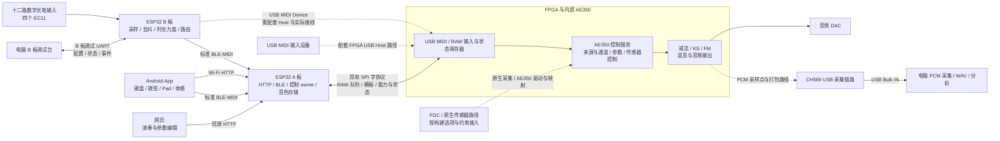

# 空灵云音：控制、客户端与外设架构

本文按本仓库源码说明各部分如何配合。它描述软件职责和接口，不把目录名称、源码存在或离线测试当成实物接线与声音验收。FPGA 内部音源、时钟和音频流水线另见 [FPGA 架构](FPGA_ARCHITECTURE.md)。

## 系统组成与数据流

FPGA 与内部 AE350 承担合成器的实时执行；ESP32 A 板提供无线入口、控制会话、音色文档和受限 FPGA 通信。ESP32 B 板是独立的激光竖琴输入控制器，把光电输入和编码器动作变成 MIDI。手机和网页负责交互，电脑工具负责调试、采集和分析。

图中虚线表示需要结合构建选项、工程约束和实物确认的外设链路。B 板没有在本架构中被分配第二组 FPGA PMOD 或另一条控制 SPI；其当前固件注册的是 USB MIDI、BLE MIDI、GPIO 与调试 UART，见 [B 板组件清单](../esp32/b_board/main/CMakeLists.txt) 和 [路由任务](../esp32/b_board/main/b_router.c)。

## 源码入口与维护边界

| 部分 | 主要职责 | 从这里阅读 |
| --- | --- | --- |
| ESP32 A 板 | 无线 MIDI、HTTP、控制状态、参数模板、存储与 SPI 门控 | [启动入口](../esp32/a_board/main/main.c)、[实际编译源清单](../esp32/a_board/main/CMakeLists.txt) |
| FPGA 配套 ESP32 副本 | FPGA 工程内保留的配套控制器源码与固件网页 | [组件清单](../fpga/firmware/esp32/main/CMakeLists.txt)、[内嵌网页](../fpga/firmware/esp32/main/web/index.html) |
| AE350 控制服务 | 原生事件、控制请求与合成器状态之间的桥接 | [control_service.c](../fpga/firmware/ae350/app/control_service.c)、[control_main.c](../fpga/firmware/ae350/app/control_main.c) |
| ESP32 B 板 | 十二路数字输入、四个编码器、演奏生命周期、USB/BLE MIDI 路由 | [b_runtime.c](../esp32/b_board/main/b_runtime.c)、[b_router.c](../esp32/b_board/main/b_router.c) |
| Android App | 原生界面、触控和体感、Wi-Fi 或 BLE 端口、离线谱夹 | [MainActivity.java](../apps/android/app/src/main/java/cn/fpgasynth/control/MainActivity.java)、[核心状态机](../apps/android/core/src/main/java/cn/fpgasynth/control/core/) |
| 独立网页维护线 | 单文件离线网页构建、交互控制器和浏览器回归 | [入口说明](../apps/web/README.md)、[runtime-controller.mjs](../apps/web/src/runtime-controller.mjs) |
| 电脑工具 | B 板配置/监控，PCM 采集与独立测量 | [host 总入口](../host/README.md) |

`esp32/a_board/` 与 `fpga/firmware/esp32/` 是两个实际存在的源码位置，不能把修改一处当成另一处已经同步。选用哪一份构建，应同时核对该目录的 CMake、`config/sdkconfig.esp32s3` 和实际固件。当前两份配置均声明 AE350 控制路径；代码仍保留其他兼容分支，不能仅凭某个旧驱动文件存在就认定它会在当前配置中运行。

编译清单明确排除了尚未集成的加法合成器驱动。历史 DIN/面板 UART 演奏路径也不能由旧文档推断为当前入口；[A 板启动代码](../esp32/a_board/main/main.c) 明确说明当前 FPGA owner 路径接受原生 USB、Web、BLE，原生传感器占用相应来源位置。内部 `dds` 标识继续用于兼容代码，完整音源在文档中称为减法合成器。

## A 板：把交互请求送到实时执行端

A 板启动事件总线、状态与控制任务，并初始化现有 SPI。AE350 模式先核对 RAW 能力、CPU magic 与 ABI，再开放受限寄存器写入；写入允许范围由 [ae350_control.c](../esp32/a_board/main/ae350_control.c) 明确列出。它不是供网络客户端任意写 FPGA 地址的通用通道。

演奏与音色编辑有不同的数据路径：

- 演奏的 Note On/Off、CC、Pitch Bend 等可作为原始 MIDI 字节进入 [raw_midi.c](../esp32/a_board/main/raw_midi.c) 的分来源队列，经 SPI 进入配套 FPGA/AE350 输入路径。
- 参数、引擎/编辑器选择、音色文档和效果器由控制 API 校验，经过 [control_source.c](../esp32/a_board/main/control_source.c)、[voice_alloc.c](../esp32/a_board/main/voice_alloc.c) 及相应 link 模块处理。模板上传、控制 owner 采用和 FPGA 原生完成状态各有自己的证据。
- 客户端的演奏 MIDI 通道与全局参数编辑器可能不同。界面应分别显示演奏路由和编辑状态，不能用一次全局编辑器变化冒充另一客户端的演奏路由变化。

连接器名称和球脚以 [当前 FPGA 约束](../fpga/constraints/control_lab.cst) 与 A 板配置为依据；本文不据此证明跳线、电平、供电或断电行为已完成实测。

## B 板：独立输入设备，不承担 A 板控制服务

B 板以独立 ESP-IDF 工程运行。GPIO 层读取数字比较器输出与 EC11，运行时引擎完成去抖、遮光计时、力度映射、关音和配置变更屏障；恢复光照后才依据完整遮光时长生成该次 Note On。模拟门限由光电模块电位器决定，固件没有从数字 OUT 虚构光强读数。详见 [B 板说明](../esp32/b_board/README.md) 和 [board_io.c](../esp32/b_board/main/board_io.c)。

[b_router.c](../esp32/b_board/main/b_router.c) 把目标演奏状态送往 USB/BLE sink，处理路由切换、旧通道清理、连接代次与重试统计。BLE 实现是发现 A 板标准 MIDI 服务的客户端，见 [ble_midi_tx.c](../esp32/b_board/main/ble_midi_tx.c)；USB 实现是 MIDI Device，见 [usb_midi.c](../esp32/b_board/main/usb_midi.c)。它们的实际接收端与连线仍应由配套系统确认。

调试 UART 是另一条管理路径，处理 `get/status/stream/apply/save` 等请求。电脑 [B 板调试台](../host/b_board_debugger/README.md) 保留草稿，匹配实际 ACK 后才更新已应用状态；只读网页监控也使用串口采集，不是 B 板上的 HTTP 服务。启动演示模式不会自动打开实体串口。

## 手机、网页与关键接口

Android 当前蓝牙入口创建标准 `BleMidiPort`，直接发送 MIDI，不执行 HTTP 的 token/context/owner 握手；Wi-Fi 则使用控制协议与设备能力门控。界面在两个端口之间互斥切换，并清除旧输入意图。私有 BLE 控制帧及测试仍保留作兼容实现，不能据此说当前默认蓝牙演奏会使用私有 RPC。证据见 [MainActivity](../apps/android/app/src/main/java/cn/fpgasynth/control/MainActivity.java)、[BleMidiPort](../apps/android/core/src/main/java/cn/fpgasynth/control/core/BleMidiPort.java) 和 [BLE 连接实现](../apps/android/app/src/main/java/cn/fpgasynth/control/BleGattLink.java)。

网页是 ESP32 可提供的同源单 HTML 页面；电脑 Node mock/preview 仅用于本地回归，不是设备运行时的后端。API 的正式注册点是 [wifi_web.c](../esp32/a_board/main/wifi_web.c)，下表只列关键接口组，不代替完整 schema。

| 接口 | 用途 | 需要区分的状态 |
| --- | --- | --- |
| 标准 BLE-MIDI / USB MIDI | Note、CC、Pitch Bend 等演奏消息 | 发送成功不证明接收端采用或实际发声 |
| `GET /api/v2/capabilities`、`GET /api/v2/state` | 能力、会话槽、模式、原生状态与参数缓存 | 能力缺失或身份不匹配时关闭对应编辑能力 |
| `POST /api/v2/session`、`POST /api/v2/command` | 建立控制绑定，提交严格七整数命令 | token、sequence、context_epoch 属于 HTTP 控制身份 |
| `/api/session`、`/api/command`、`/api/state` | 保留的 v1 控制兼容入口 | v1 五整数与 v2 七整数不能混用 |
| `POST /api/v1/midi/raw` | 提交有绑定身份的原始 MIDI 字节 | RAW 排队回执不等于控制命令已采用；名称中的 v1 不代表五整数命令格式 |
| `/api/v2/fm/catalog`、`/api/v2/fm/diagnostics` | FM 目录、分页与诊断 | schema/profile/运行维度及上下文都需匹配 |
| `/api/v2/fdc` | FDC 状态、显式启停和六字段标定 | `202` 是入队，`transport_sent` 是传输层状态 |
| `/api/v2/ks/timbre`、`/api/v2/ks/presets` 及其文档/加载子接口 | KS 音色与预置文档 | 本地文档校验、加载任务和设备采用分别确认 |
| `/api/dds/presets`、`/api/dds/status`、`/api/dds/result` | 减法音色的异步文件任务 | 任务身份与完成上下文必须对应本次请求 |
| `/api/v2/effects/reverb`、`/api/audio/routes` | 混响与输出路由 | 传输结果、状态读回与真实音频效果分开验收 |

HTTP 原始 MIDI 的编码与回执检查见 [raw-midi.mjs](../apps/web/src/raw-midi.mjs)、[http_raw_midi.inc.h](../esp32/a_board/main/http_raw_midi.inc.h)。控制 API 的 `202`、ESP32 owner 处理完成、SPI/CPU/native 完成和实际出声是不同阶段。后台、失焦、网络故障、来源租约到期及 STOP 都需要清除旧演奏意图；连接恢复后不能自动重放先前按住的 Note On。

## FDC 与手机体感是两种传感器路径

FDC 属于配套 FPGA/AE350 原生传感器链路：AE350 应用层轮询、校准、启停与控制映射见 [fdc_application.c](../fpga/firmware/ae350/app/fdc_application.c)，原生 owner 适配见 [fdc_native_owner.c](../fpga/firmware/ae350/fdc_integration/fdc_native_owner.c)。A 板和网页提供状态及显式控制入口，不能由“网页存在 FDC 面板”推断 ESP32 在直接采集传感器。具体 FDC/ToF 的选择及 I/O 接入须结合该次构建与 FPGA 约束确认。

Android 体感则读取手机自身传感器，经 [SensorMidiMapper](../apps/android/core/src/main/java/cn/fpgasynth/control/core/SensorMidiMapper.java) 映射成 MIDI 消息，再由当前选定端口发送。它不等同于 FPGA 的 FDC 标定，也不是在手机内生成合成器 PCM。

## 配置与数据保存在哪里

| 保存位置 | 内容与边界 |
| --- | --- |
| A 板 sdkconfig、分区表与 `storage/` | 构建配置、Factory 音色种子与 FAT 数据区布局；[CMake](../esp32/a_board/CMakeLists.txt) 单独生成存储镜像，不把普通固件更新当成覆盖 User 文档的授权 |
| A 板 FAT / NVS | 减法预置与启动设置等；[dds_presets.c](../esp32/a_board/main/dds_presets.c) 挂载失败不自动格式化，运行时 RAM 状态也不等于已写 Flash |
| B 板 NVS | `harp_b` 命名空间的 settings blob；配置有显式保存流程，见 [b_storage.c](../esp32/b_board/main/b_storage.c) |
| Android 私有文件目录 | `scores/` 中的图片/PDF和 JSON 索引；见 [ScoreFiles.java](../apps/android/app/src/main/java/cn/fpgasynth/control/ScoreFiles.java)。谱夹是离线阅读数据，不是 FPGA 音色存储 |
| 网页/手机运行时内存 | 触点、待发消息、编辑草稿、会话身份和设备缓存；不能当作 NVS 或真实芯片参数读回 |
| 电脑采集目录 | 原始流、PCM、WAV、统计与测量结果；不由控制 API 上传至设备 |

## PCM 采集与两份网页的边界

[host/pcm_capture](../host/pcm_capture/README.md) 是当前 CH569 采集工具，包含 USB Bulk/串口读取、流解析、双声道 signed32 等格式、WAV 和统计。它观察配套 PCM 输出，不能用收到字节证明所有音源参数正确；实际采样点、速率与传输完整性必须按 FPGA 配置和本次采集元数据核对。

[host/pcm_measurement_reference](../host/pcm_measurement_reference/README.md) 是独立参考维护线，包含另一套 CRC/mono16 契约和音频测量实现，不能与当前采集器的帧解析混用。FakeReader 验证文件与界面流程，不证明 CH569、FPGA 或音频硬件已工作。

网页同样有明确的两个位置：

- [apps/web/src](../apps/web/src/) 是独立维护源码，构建生成 `apps/web/dist/index.html`；生成物按项目规则忽略，不随源码提交，构建方式见[网页说明](../apps/web/README.md)。
- [fpga/firmware/esp32/main/web/index.html](../fpga/firmware/esp32/main/web/index.html) 是该配套固件实际保留并由其 CMake 压缩嵌入的页面；A 板副本也有自己的内嵌页面。

本次没有用独立网页的新产物覆盖固件页面。两条维护线存在已记录的 FDC 身份/页面预期差异，旧 8 声部和旧 FDC1 门控的部分浏览器入口也保留了过期断言。具体通过项与失配见 [网页验证范围](../apps/web/README.md)。因此，独立网页测试通过不代表固件内嵌页面已经同步，不能宣称全部历史网页测试均通过。

`apps/android/contracts/`、ABI 参考归档及 retired 测试目录用于冻结接口、回归和来源核查，不会自动成为设备运行固件。其他旧镜像和参考源也应通过实际组件清单、工程配置及调用关系判断是否参与当前生产构建。

## 阅读与验收边界

源码可以确认模块职责、协议格式、来源隔离与保存策略；它不能单独确认外设跳线、供电、USB Host 角色是否正确接入、BLE 多端并发、传感器采样质量、小时级 PCM 连续性或 DAC 声音。涉及这些项目时，应记录配套固件/位流、配置和本次实物证据，不从目录命名或历史记录推断当前状态。

本次文档整理和仓库上传不包含后续综合、布局布线或硬件编程。
