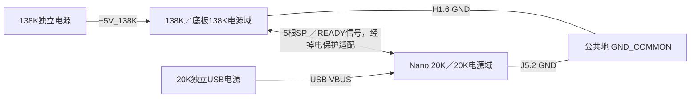
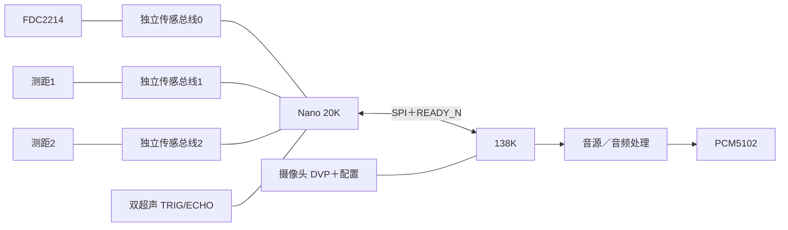

# 20K / 138K 拓扑、桥接与布局规划

2026-10-28。**规划候选，未修改 CAD / RTL / CST，未实施或烧录。** 最新分工优先于前轮评估：摄像头留在138K。

## 结论

1. 20K负责FDC2214、两路测距、两路超声、传感器标定/滤波/映射。当前不规划OLED或RGB LCD，也不为显示预留GPIO。138K负责摄像头、音源和PCM5102。
2. 第一版不需要合并I²C；保留三对传感器物理总线。也不让两块FPGA同时做同一外设总线的控制器。
3. 板间优先采用独立SPI（4线）+数据就绪（1线）。普通运行传递20K已经计算好的原生演奏控制量；原始读数用于诊断，MIDI事件作为可选载荷，不额外拉一组MIDI线。
4. 按用户最新要求，将H1/H2/H3/H4两组40-pin及FDC的位置/方向锁定；Nano放在两组40-pin之间、USB朝上。其他模块、安装孔和排布可调整。保持约100×100mm外形作为候选；同面分层安装必须验收Z高度。
5. 移除OLED后，中置版使用23根20K信号：17外设+5桥接+1本地功放关断。为缩短板间连线，5根SPI/READY改到Nano右排相邻位置；以本目录CSV为准，替代此前聊天中的第一版针表。34个引出信号中还有11个未分配；新释放71／J5.18为板载负载较少的GPIO，55／J5.11仍接功放LRCLK，其余9个仍有板载共用条件。
6. **用户已确认供电方式：两块FPGA独立供电，GND连接，5V正极不互接；两块板的3.3V稳压输出也不并联。** 20K首版使用独立USB供电，底板不向其J5.1注入138K的5V。详细接线见下节。

## 独立供电与公共地（已确认）

138K保持自己的供电入口；Nano 20K首版采用独立USB供电。这里的“独立”指正电源分别供给，**不表示两块板电气隔离**：当前SPI为非隔离直连规划，必须有公共地。

| 接线 | 首版处理 |
| --- | --- |
| 138K电源正极 | 只供138K侧，标为`+5V_138K` |
| 20K USB VBUS／板内5V | 由独立USB供给，属于`+5V_20K` |
| Nano J5.1（板内+5V） | 底板侧NC／不接；它会随20K USB带电，不能并到`+5V_138K` |
| Nano J5.16、J6.19（板内3.3V） | 不并到138K或AMS1117的3.3V输出；需要使用时只归属20K侧电源域并核算负载 |
| 公共地 | **H1.6 GND → 底板公共地 → Nano J5.2 GND**；J5.15/J6.20也是Nano地，可按布线需要增加回流连接 |
| 板间信号 | 原5根信号针位不变；接线至少包含这5根信号和1根GND，GND不消耗FPGA GPIO |

原理图使用`+5V_138K`、`+5V_20K`及各自3.3V网络名区分电源域，只把GND公共连接，避免通用`+5V`标签意外合网。0Ω信号选路不得把两路正电源桥接；GND固定相连，不随模块归属选择而断开。

Nano USB VBUS与J5.1经板上保险丝相连，保险丝不是反向隔离。若以后改由**另一独立5V电源**经J5.1供电，需要与Nano USB的5V互斥或另做电源选择；本版不采用这种接法。传感器模块的供电、上拉和电平适配仍需按实际模块规格落实，不能因为SPI共地就把它们的5V/3.3V电源全部合并。

独立供电允许任一块板先上电或先断电，跨板接口因此还必须满足下文的掉电保护条件。供电拓扑已确定，具体保护器件和电源有效使能电路尚未实现或验收。接线图见 [独立供电与通信图](power-and-interconnect.png)，完整表见 [电源与公共地表](power-ground-wiring.csv) 和 [6线板间接线表](interboard-wiring.csv)。

## 推荐拓扑

图中传感器信号经过模块级0Ω选路，默认归20K；不表示已经修改现有铜线。两FPGA之间不直接共享上述传感总线。摄像头SCCB/图像数据保持138K本地，视频不经过该控制SPI。

20K可以复用已有“一个传感器I²C事务引擎＋调度器＋三组引脚选择”的结构，而不必复制三份完整引擎。当前不安排显示引擎；三条物理总线不是三个必须全速并行的控制器。

## I²C是否共用

| 选项 | SCL/SDA信号总数 | 20K合计信号数 | 评价 |
| --- | ---: | ---: | --- |
| FDC、ToF1、ToF2各独立 | 6 | **23** | 第一版推荐；便于故障隔离和调试 |
| 三个传感器合并 | 2 | 19 | 省4脚，但双ToF需改址与恢复策略 |

这些总数保留ADDR/SD/XSHUT/INT、超声、5根桥接线和功放关断，未通过删中断或固定配置继续省脚。摄像头不计入20K预算；12路独立激光束琴输入、EC11也不在此预算内。OLED与RGB LCD均不规划，也不预留显示GPIO。

**当前没有必要为省4脚而立即合总线。** 先保留三组独立传感总线；需要扩展时再评估合并。

I²C按开漏设计，上拉与总线电容共同决定上升沿；不能把多个模块的上拉电阻盲目并联。[NXP UM10204](https://www.nxp.com/docs/en/user-guide/UM10204.pdf)。裸FDC2214供电2.7–3.6V，模块VIN标5V并不能证明信号电平合适。[TI手册](https://www.ti.com/lit/ds/symlink/fdc2214.pdf)。

若实物确为VL53L0X，两片可在独立总线使用同一7位地址0x29（文档的0x52是含R/W位的写地址表示）。合总线须先控制各自XSHUT、逐片释放并分配不同地址，复位后重新配置；不能直接并联两个默认同址器件。[ST手册](https://www.st.com/resource/en/datasheet/vl53l0x.pdf)。当前图纸只写“激光测距”，实物型号仍须核对。

两FPGA同时控制同一外设总线需要多控制器仲裁与恢复支持，当前方案没有这个需求。138K需要外设读数或改配置时通过SPI请求20K；0Ω/开关用于**断电改变归属**，不是运行中的总线仲裁器。

## MIDI、原生参数与物理桥接分开选择

| 传输方式 | 信号脚（不计GND） | 能传的数据 | 本项目评价 |
| --- | ---: | --- | --- |
| 传统MIDI UART | 单向1；双向2 | MIDI 1.0消息 | 适合兼容/简单演奏，不适合作为唯一的高频连续量、诊断和配置通道 |
| 自定义UART | 2；流控可再加 | MIDI或自定义帧均可 | GPIO吃紧或外接线条件需要时的备选；速率/电气同样需验证 |
| **SPI＋READY_N** | **5** | **原生控制量、配置、状态、MIDI事件** | **本轮推荐；引脚够用，事务边界清楚，138K可主动轮询** |
| 专用板间I²C | 2；中断可再加 | 寄存器/消息 | 可实现，但不与传感器总线混接；首版没有省这3脚的必要 |
| 并行数据接口 | 通常≥10，依握手定义 | 大吞吐数据 | 当前只有控制量需求，没有必要付出引脚/CDC/布线成本 |

MIDI是数据语义，不等于必须使用31.25kbaud串口。SPI也能承载MIDI消息；传统MIDI串口一条3字节消息按8N1需0.96ms，Pitch Bend加一条CC共6字节需1.92ms（不使用running status的计算），持续高更新率时会挤占带宽。MIDI over SPI不受这个串口速率上限，但仍有MIDI的声道、弯音范围、参数映射和接收端实现约束。[MIDI官方规格入口](https://midi.org/midi-1-0-detailed-specification)。

### 首版载荷建议

- `CONTROL_STATE`：active、group、14位绝对音高、17位Q16音量、有效/故障掩码、测量时间/样本年龄。音高沿用现有每八度1024码；65536表示unity音量。
- `RAW_SNAPSHOT`：28位FDC读数、ToF/超声距离、错误与样本计数，主要用于诊断/标定，不让138K重复执行整套滤波映射。
- `CONFIG`：采集模式、标定端点、启停、滤波参数；需序号、确认和读回。
- `EVENT`：预留MIDI/离散演奏事件模式；同一演奏源不同时用连续参数和MIDI重复驱动同一声部。实际启用前定义来源、声部与停止语义。

**接收端现状不能忽略**：主树 `src/control_input/README.md` 明确source3是原生传感器来源，RAW MIDI source3被拒绝；source0/1/2已有USB/Web/BLE用途。首版应接原生source3接口，不能把新20K数据冒用BLE来源，也不能认为传到现有SPI邮箱就已支持MIDI。若选择MIDI模式，需显式增加/适配来源和接收路径。该README也明确现有原生传感器接口尚未驱动所有音源声部，因此仍须做138K端声部适配，不承诺“链路通了就能发声”。

## SPI电气与协议候选

138K做主机，20K做从机；与ESP32现有SPI独立。沿用旧20P第9～13针对应的138K球位，但新板优先从固定H1/H2对应针直接走线，不绕旧20P。旧20P可移动/改作调试扩展；以下针号只作为原网别名：

| 信号 | 旧20P | 138K球位 | Nano芯片脚／排针 |
| --- | ---: | --- | --- |
| SCLK | 9 | A19 | 42／J5.5 |
| MOSI | 10 | A18 | 41／J5.6 |
| MISO | 11 | C17 | 48／J5.10 |
| CS_N | 12 | D17 | 54／J5.8 |
| READY_N | 13 | B18 | 56／J5.7 |

五球位为PG484A BANK2；前轮已查当前活动CST无同球位占用，但这不是实物电压/完整CAD无冲突验收。Nano以3921为基线。旧20P没有供电和GND；本版从**H1.6接底板公共地，再到Nano J5.2**，不能把旧20P备用信号针直接短接为地。新板可新增带地的专用连接器，但必须同步改其走线，避免把旧FPGA信号硬接地。两块板独立供电，板间线束不传5V或3.3V。

- Mode0、MSB first；1MHz联调，2MHz作为后续时序/实板验证目标。
- 固定64字节全双工帧；1MHz纯移位512µs，2MHz为256µs，另计CS等待/帧间隔。最多1kHz取快照只是通信调度目标，不代表传感器产生1kHz新测量。
- 帧定义候选：0–1 magic；2 version；3 type；4–5 seq；6–7 ack；8–11 session；12 length；13 flags（含ACK_VALID）；14–15保留0；16–61 payload（最多46字节）；62–63 CRC16。
- 多字节大端；CRC16/CCITT-FALSE覆盖0–61字节，poly=0x1021、init=0xFFFF、refin/refout=false、xorout=0。版本不兼容、CRC错、长度非法或不足/多于64字节均整帧拒收，不更新控制状态。
- HELLO/能力与会话确认后才接受控制/配置。20K在CS开始前准备MISO快照，本帧MOSI命令的结果最早下一帧返回，不许在一帧中混入新旧样本。
- 连续量采用最新值快照；配置和事件必须ACK/去重，不能像连续量一样无条件覆盖丢弃。先保证Note Off/释放不丢失，再扩展事件吞吐。
- 20K以27MHz本地时钟为首版候选，迁移驱动必须修正CLK_HZ等参数。SPI接收先按该本地时钟同步/边沿检测评估，不在普通逻辑中随意派生SCLK时钟；发送保持和采样路径必须实际做STA与实板验证。
- 单比特READY_N同步后使用；整组控制量用完整载荷握手/双缓冲跨域，不逐位各自双触发器同步。
- 超过100ms没有有效通信/样本则仅撤销传感器active、令原生增益0；兼容调制回中性。不要复位主音源、停其他MIDI来源或把过期音高继续作为新样本。
- CS_N的接收侧默认电平应为高；READY_N采用开漏或释放、138K侧上拉；MISO在未选中时释放。上拉归属本地电源域，且必须配合掉电隔离适配，不能靠跨板上拉给未上电的对端供电。预留驱动端串阻位置，初装值/是否改阻值由实际波形决定；不靠降低时钟频率掩盖过冲和回流问题。

### 独立供电时的接口状态

| 电源状态 | 跨板接口要求 |
| --- | --- |
| 两板均断电 | 公共地保持连接；两路正电源无并联路径 |
| 仅138K上电 | 不向20K的SCLK/MOSI/CS或其他IO注入电流；138K内部可保持SCLK低、CS高，跨板输出保持隔离 |
| 仅20K上电 | MISO/READY及其他跨板连接不能给138K反向供电；20K可以本地运行，不能把输出驱动到未上电对端 |
| 两板上电、未握手 | 电源有效后允许HELLO/能力确认；演奏控制仍为无效，确认会话后再应用参数 |
| 任一板掉电后恢复 | 先禁用跨板驱动并使旧控制失效，恢复后重新握手；不重放上一会话的演奏事件 |

**仅有RTL高阻、开漏、0Ω或普通串联电阻，不能证明掉电不反灌。** 实现时须选择有明确`Ioff`／partial-power-down能力的缓冲/电平适配，或取得能直接连接的器件级证据并实测验证；保护范围须覆盖两个方向的全部5根信号及上拉路径。适配使能只在两侧电源有效时释放，检测/使能电路也不能产生新的反灌路径。器件型号、使能实现和实测结果仍为未决项，当前不声称已支持任意上电顺序。

## 0Ω与开关选路

每个可迁移信号：`138K信号—R138—模块公共端—R20—20K信号`。默认只装R20；原有直连铜线不能绕过选择点。17根外设信号需34个电阻位置，默认装17颗，按模块集中标注归属。信号选择不用于切换/并联两块板的稳压输出。

双刀双掷开关可以选择SCL/SDA，但FDC的SD/ADDR、测距的XSHUT等也必须与该模块归属匹配；单个DPDT不等于整模块切换。采用断电切换、先断后接的选择方式。纯输入可按电气条件扇出，但首版仍建议保持模块归属清楚。

摄像头、PCM5102固定138K，不加进默认迁移选择。特别是旧测距1预案的A15/B20/B21与当前PCM_WS/DIN/BCK冲突，138K回退支路必须保持DNP，重新规划后才能焊接。

## 布局与尺寸

详见 [排针和安装规划](mechanical-layout.md)、[布局图](layout-proposal.png)、[23脚表](nano-pin-plan.csv)、[桥接表](fpga-link-plan.csv)、[40针本地坐标](nano-header-local-mm.csv)、[候选放置坐标](nano-header-placement-proposal-mm.csv)。

推荐Nano在两组40-pin之间竖放，J6在左、J5在右；中置版的SPI集中Nano右排，对接固定H1/H2，端点直线距离约12.96～21.87mm。两组40-pin和FDC合计88个焊盘坐标锁定，其他模块与安装孔可调整。FDC接口附近放其0Ω选择和电平适配；尽量让数字回流不穿过其模拟/天线区域。同面安装时Nano处于138K投影下，必须检查上下板器件、插座高度和USB线缆。

## 验证与未决边界

- 已核对：23脚无重复、40孔坐标按2.54×20.32规则一致、5条旧20P网络与候选连接匹配；读取现有PCB坐标和5条历史走线总长。
- 尺寸取官方3921尺寸图、DXF/iBOM的板边中心线及J5/J6焊盘；本地坐标改为USB朝上、J6.1为原点，没有假设板边距对称。
- 当前转接板仍无已保存原生SCH，本次读取其导入历史PCB；布局图不是未保存窗口的截图，也不是已布线结果。历史源/PCB差异仍沿用前轮问题清单。
- 具体模块电平/上拉、Nano实物版号、插座型号与高度、PCM模块板体、机壳与线缆尚未形成实物/3D验收。未做完整ERC/DRC、STA、仿真或硬件测试。
- 独立电源与共地方式已由用户确认；两侧5V/3.3V不并联。单板断电时的IO反灌保护、两侧电源有效使能及上拉路径尚未选型/验证，属于后续电路验收项。
- 当前不规划OLED、RGB LCD及显示载荷，也不为显示预留GPIO。若以后需求是摄像头实时图像显示在20K，或把音频示波/FFT迁到20K，必须单独规划像素/采样数据链路；本控制SPI不等于已提供视频桥。
- 本目录只是规划资料；本轮未改CAD、RTL、CST、SDC、固件或启动构建/设备写入。
