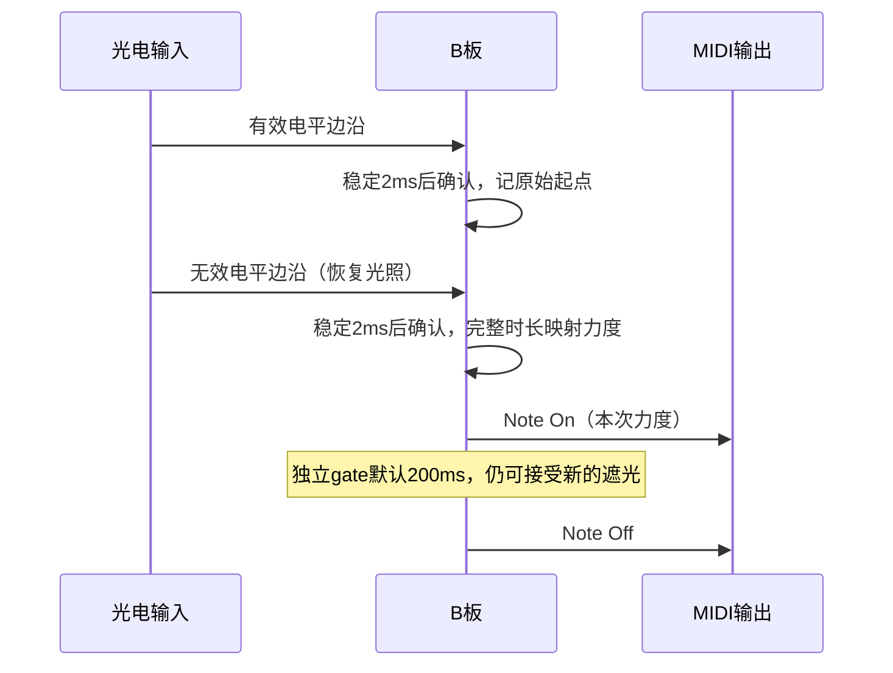

# B 板接口报告

日期：2026-10-28。对应源码：`firmware/b_board/`，独立 ESP32-S3 项目。本轮结构化改造后的生命周期与任务表见 [结构/调度报告](b-board-lifecycle-and-debug.md)，完整机器调试协议见 [UART协议v1](b-board-debug-protocol.md)，桌面程序见 [上位机说明](../../host/b_board_debugger/README.md)。本文定义 B 板现有行为及对接契约；A/FPGA 的兼容性、容量和结构问题单独记录在 [兼容性与结构问题](b-board-integration-issues.md)。

## 1. 角色与边界

| 模块 | 职责 | 对接方向 |
| --- | --- | --- |
| B 板（本项目） | 十二路光电输入、四个 EC11、遮光计时、力度/音符/控制事件、发送状态 | USB MIDI Device；BLE MIDI central |
| A 板（原 ESP32 主工程） | 接收 B 的无线 MIDI，继续承担已有 FPGA 通信 | BLE MIDI peripheral / GATT server |
| FPGA 合成器 | 接收和解释 MIDI，分配声部并合成声音 | USB MIDI Host；A 板已有链路 |

B 不使用 A 的 SPI/LED 引脚分配。本次仅实现 B，不修改 A、FPGA 或 CAD，不烧录设备。

## 2. 光电输入契约

原理图 `IOxx` 按用户确认直接表示 MCU `GPIOxx`。输入是数字电平，不读取 ADC。已按原电路意图完成 [IO 接收逻辑审查](b-board-io-review.md)，默认极性由早期低电平纠正为高电平；导入差异不作为实物故障。

| 通道 | 比较器网络 | GPIO | 默认 MIDI Note |
| --- | --- | --- | --- |
| 1 | 1OUT | 4 | 60 |
| 2 | 2OUT | 5 | 61 |
| 3 | 3OUT | 6 | 62 |
| 4 | 4OUT | 7 | 63 |
| 5 | 5OUT | 15 | 64 |
| 6 | 6OUT | 16 | 65 |
| 7 | 7OUT | 1 | 66 |
| 8 | 8OUT | 2 | 67 |
| 9 | 9OUT | 42 | 68 |
| 10 | 10OUT | 41 | 69 |
| 11 | 11OUT | 40 | 70 |
| 12 | 12OUT | 39 | 71 |

- 默认高电平有效（遮光），低电平无效（恢复光照）；可通过配置或 `harp polarity` 翻转。GPIO 内部上拉打开。
- 正常运行每 1 ms 扫描，两侧电平均需稳定 2 ms。维护命令和 Flash 写入不具备同样的实时保证。
- 计时起止采用通过稳定确认的原始候选边沿时间。短暂抖动不产生多次事件，稳定时间不足 2 ms 的脉冲被滤除。
- 上电已遮光的通道不触发；恢复光照后重新武装。Panic 同样要求当前遮光通道先恢复，再开始新的遮光周期。

### 发声时序

用户已选择“遮光结束后发声”。每路状态如下：



图中发声 gate 与输入计时独立运行：等待自动关音期间仍接受下一次遮光。再次释放时，若同一音高仍在发声，则按 `旧 Note Off → 新 Note On` 顺序重触发。十二路可以同时计时和发声；B 能输出十二个不同音符，接收端实际复音数量见额外问题文档。

### 遮光时长到力度

默认 `t_min=20 ms`、`t_max=500 ms`、`v_short=127`、`v_long=16`，遮光越短力度越大：

```text
t = clamp(完整有效电平持续时间, t_min, t_max)
velocity = round(((t_max - t) × v_short + (t - t_min) × v_long) / (t_max - t_min))
```

| 遮光时间 | ≤20 ms | 100 ms | 260 ms | ≥500 ms |
| --- | --- | --- | --- | --- |
| Note On velocity | 127 | 109 | 72 | 16 |

越短力度越大、越久力度越小；力度 0 不用于 Note On，避免被 MIDI 接收端解释为 Note Off。发声长度由 `gate_ms` 独立控制，默认 200 ms，起点为释放完成稳定确认的时刻。修改力度曲线/gate 影响之后完成的遮光周期；已发音符保留触发时的力度和截止时刻。计时及 gate 均支持 32 位毫秒计数回绕。

## 3. 编码器输入与功能

每个 EC11 提供 A、B、SW 三个输入，A/B 上拉，按键低电平有效。默认每档 2 个合法正交边沿，可改为 4；方向可逐编码器反转。AB 双位同时跳变计为非法并清空未完成步进；按键稳定确认 20 ms，无长按连发。

| 控件 | 旋转功能 | 按键功能 | 初值/范围 |
| --- | --- | --- | --- |
| ENC1 / SW4 | 半音移调 | 微调 −1 cent | 移调 0，范围 ±24 半音；微调 ±100 cents |
| ENC2 / SW5 | CC7 通道音量 | 微调 +1 cent | 音量 100，范围 0–127 |
| ENC3 / SW6 | CC74 截止频率 | CC74=127、CC71=0 | 截止 127，范围 0–127 |
| ENC4 / SW7 | CC71 共振 | Panic | 共振 0，范围 0–127 |

实际 MCU GPIO 是独立配置项。默认四组均为 `-1 -1 -1`，即禁用而非猜测引脚。已取得的 H1/H2 连接见 [接线记录](hardware-wiring.md)，不把排针针号当成 GPIO。

引脚绑定每组须完整启用或完整禁用；不允许跨编码器复用同一 GPIO。当前 YD-S3 配置允许 `1,2,8,12,13,14,21,38,39,40,41,42,47`，保留激光、USB19/20、UART43/44、存储、启动绑带及 RGB 引脚。

## 4. MIDI 事件契约

采用 MIDI 1.0 通道消息。默认报文通道编号为1（0～15编号），对应常用叫法的通道2（1～16）；状态字节低四位为1。Kconfig/RPC配置沿用常用通道号1～16，人工串口命令及桌面选择框使用报文编号0～15。默认第一路音符60，构建默认可配置24–92；运行时可以通过UART设置十二路互不重复的0–127音符，移调越界通道暂时静音。

2026-11-03 通道约定：接收端通过 MIDI 通道区分合成引擎，激光竖琴 B 板采用报文通道编号1，因此构建默认显式设为 `CONFIG_B_MIDI_CHANNEL=2`（配置使用常用通道号）。十二路光敏音符、EC11 的 CC/Pitch Bend 与 Panic 均共用该通道，USB/BLE 不重新分配通道。光敏弦号1～12表示输入通道，以 Note 区分；发送 MIDI 通道为独立的全局配置。有效 NVS 配置仍优先；启动日志同时显示报文编号和常用通道号，`get` 的 `channel=2` 对应报文编号1。

以下字节均为十六进制，示例使用默认报文编号1（常用通道2）：

| 事件 | MIDI 字节 | B 的语义 |
| --- | --- | --- |
| Note On | `91 nn vv` | 光束恢复后，按本次完整时长确定力度；`vv=01..7F` |
| Note Off | `81 nn 00` | gate 到期、重触发前、旧音高释放或切路释放 |
| 音量 | `B1 07 vv` | CC7，与 Note On velocity 分开保存 |
| 截止频率 | `B1 4A vv` | CC74 |
| 共振 | `B1 47 vv` | CC71 |
| 微调 | `E1 ll hh` | 14 位 Pitch Bend，低 7 位在前；中心 `00 40` |
| All Sound Off | `B1 78 00` | 新连接/重新初始化/Panic 的清理起点 |
| All Notes Off | `B1 7B 00` | 紧随 CC120 清理 |

微调换算为 `8192 + round(cents × 8192 / 200)`，假设接收端弯音范围 ±2 半音。B 不发送 RPN 来改变接收端范围。ENC1 改变实际 MIDI Note 编号；两个调音按键改变 Pitch Bend。

发送顺序：新连接先清理 CC120/123，再同步 CC7/74/71 与 Pitch Bend，最后发送有效音符。正常状态差异优先处理 Note Off，再更新控制器，最后发送新 Note On。每次击弦有全局唯一递增编号，避免移调重合或异步发送时把不同力度的两次触发混为一次。

## 5. USB MIDI 接口

- B 为全速 USB MIDI Device，FPGA 必须提供 USB Host。
- 使用 YD-ESP32-S3 原生 **USB2**：D−=GPIO19、D+=GPIO20。USB1/CH343P 是串口接口。
- 产品字符串 `Laser Harp B`，序列号由芯片 MAC 生成，MIDI 接口名 `B MIDI`。
- 单 cable 0；Audio Control + MIDI Streaming 两个 interface；bulk OUT `0x01`、IN `0x81`，最大包 64 字节。
- 每个 MIDI USB event 为四字节：`CIN/cable, status, data1, data2`。

例如默认gain=100%时，遮光100 ms、音符60、力度109的Note On：

```text
MIDI:      91 3C 6D
USB event: 09 91 3C 6D
Note Off:  08 81 3C 00
```

B 只在已枚举且未挂起时认为 USB 可用。USB 主机发送到 B 的 MIDI 输入会被读取并丢弃，本版不把它作为控制输入或桥接到 BLE。

## 6. B → A 的 BLE MIDI 接口

| 项目 | 契约 |
| --- | --- |
| B 角色 | central / GATT client，主动扫描并连接 |
| A 角色 | peripheral / GATT server，名称默认 `FPGA_Bluetooth` |
| 名称来源 | 当前 A 源码将完整名称放在 Scan Response，B 使用 active scan |
| Service UUID | `03B80E5A-EDE8-4B33-A751-6CE34EC4C700` |
| Characteristic UUID | `7772E5DB-3868-4112-A1A9-F2669D106BF3` |
| 写方式 | Write Without Response，发现特征时验证该属性 |
| 消息大小 | 本版每次一条通道消息，5 字节；两字节 MIDI 消息则为 4 字节 |
| MTU | 本版消息可放入默认 ATT MTU，不依赖增大 MTU |
| 自动重连 | 失败/断开后调度重试，再发现服务/特征，重新同步状态 |

BLE payload 不是 USB 的四字节 event。使用 13 位毫秒时间戳，每包包含完整 MIDI status，不使用 running status：

```text
byte0 = 0x80 | ((timestamp_ms & 0x1FFF) >> 7)
byte1 = 0x80 | (timestamp_ms & 0x7F)
byte2.. = MIDI status + data

时间戳0、报文通道编号1、音符60、力度109：80 80 91 3C 6D
时间戳0、音符60关音：   80 80 80 3C 00
```

本版不要求 A 订阅 B 的 notification；B 不提供 MIDI peripheral 服务，也不负责接收 A 的 MIDI 反馈。B 当前没有主动配对命令或持久绑定流程，A 若开启强制加密须另行验证。

BLE 写在 NimBLE host queue 串行执行；每个连接带有 epoch，旧连接的异步发现/发送结果不能成为新连接的有效确认。主状态机在对应消息被发送 API 接受前保留相同 payload；拥塞时重试，不用尚未发送的状态覆盖已排队消息。无响应写的成功仅表示本地发送 API 接受，**不是 A/FPGA 已执行的确认**。

## 7. 路由与断连

| 模式 | 行为 |
| --- | --- |
| `auto`（默认） | USB 已就绪则选 USB，否则选已就绪的 BLE |
| `usb` | 仅 USB |
| `ble` | 仅 BLE |
| `both` | 两路均就绪时同时发送 |

切换路由先向旧 sink 提交关音，旧 sink 无待处理消息/音符后，再向新 sink 发送当前状态。各 sink 单独保存已接受音符和控制器状态。断连丢弃该连接的发送影子；接收端必须在断连/flush 时清掉该来源的旧音符。重新连接只恢复仍处于 gate 内的音符，已过期的短音不回放。

跨 USB/BLE 没有共享的远端完成屏障。当前 A/FPGA 源码按 MIDI source 隔离音符，但切路或 `both` 仍可短暂叠音/重触发；细节见额外文档。

## 8. UART 配置接口

USB1/CH343P、UART0 GPIO43/44、115200 baud。命令通过有界队列交给状态owner；独立UART RX/TX任务不直接改音乐模型/GPIO，原生USB2仍专用于MIDI。人工harp命令输出JSON；机器RPC支持id、revision、原子apply和真实完成ACK，详见协议v1。

| 命令 | 参数与作用 |
| --- | --- |
| `harp get` / `harp channel` | 查询完整配置，同时返回报文编号 `midi_channel_id`（0～15）与 `config.channel`（1～16） |
| `harp channel 编号` | 编号0～15；等待旧通道清音后选择USB/BLE共同发送通道，显式save才跨重启保存 |
| `harp status` | 返回原始/遮光/发声位图、最近时长/力度、引脚、链路及计数；独立 UART TX 任务输出快照 |
| `harp velocity min_ms max_ms min_v max_v` | `1 ≤ min_ms < max_ms ≤ 60000`，两个力度端点各为1–127，允许倒向 |
| `harp gate ms` | 后续击弦发声时长，10–5000 ms |
| `harp polarity 0或1` | 遮光有效电平，清掉输入状态并重新武装 |
| `harp encpins 编号 A B SW` | 编号 1–4，填实际 MCU GPIO；`-1 -1 -1` 禁用 |
| `harp route auto或usb或ble或both` | 选择输出路由 |
| `harp transpose 半音` | −24…+24 |
| `harp fine cents` | −100…+100 |
| `harp volume 值` | CC7，0–127 |
| `harp panic` | 清音并要求被遮光通道重新武装 |
| `harp save` | 在演奏间隙显式写 NVS |

命令队列16项，每扫描循环最多处理2项；ACK队列8、状态快照1、击弦事件64。回复在owner实际应用后产生，save在Flash真实完成后回复。满队列/版本冲突/非法配置有明确错误；这些ACK仍不是A/FPGA执行完成确认。

保存项：MIDI 通道、十二路 notes/gains、路由、移调、微调、音量、截止/共振、极性、去抖、力度曲线、gate、编码器 GPIO/方向/每档边沿数。B 的私有 NVS namespace 为 `harp_b`，key 为 `settings`，magic `0x42524833`（224字节canonical v3，含CRC，可迁移100字节v2）；长度、版本、范围、引脚均校验，失效则使用构建默认，不自动擦除 NVS。此 blob 不是 A/B 通信协议，A 不读取它。

## 9. 软件模块接口与并发

| 模块 | 职责/主要接口 |
| --- | --- |
| `harp_core` | `harp_sample` 接收输入快照和毫秒时间；`harp_target` 生成逐音符力度/编号；`harp_sink_pump` 处理差异与发送确认 |
| `board_io` / `b_pinmap` | B 专用引脚、完整性/冲突校验、GPIO 输入 |
| `usb_midi` | USB 描述符/ready/epoch/四字节事件发送 |
| `ble_midi_tx` | 扫描、连接、GATT 发现、host queue 发送及 epoch 校验 |
| `b_runtime` / `b_engine` | 单一输入/配置owner；维护生命周期；两个sink由独立router持有 |
| `b_console` | 专属UART RX/TX，命令入队、独立ACK、快照/事件输出 |

音乐/配置由输入owner独占，sink由router独占；BLE host queue拥有GATT操作，TinyUSB任务处理USB；UART和NVS各有低优先级任务。channel/polarity/pins及保存先等待旧通道清音屏障，输入暂停维护后重新武装。

## 10. 验证与交付

- 本机 ESP-IDF v6.1、esp_tinyusb 2.4.0、tinyusb 0.21.0~2 实际构建成功，应用镜像 `0x7F980`（522624）字节。
- C 主机测试：原15个行为组、3组映射/gain/倒向与试奏、GPIO校验，以及配置/RPC/维护/CRC与迁移，ASAN/UBSAN通过；54包B→A现有解帧器兼容仍通过。
- 上位机27项通过，包含真实pyserial PTY及Xvfb下实际Tk窗口；9次事务将PC实际请求编码/帧解析与真实C核心连通。未连接实物。
- 包含去抖、启动遮挡、极性、时间戳回绕、正交方向/非法跳变、完整时长→力度、独立 gate、同音重触发、移调重合、异步 pending、拥塞和连接换代测试。
- 构建：`./firmware/b_board/build.sh`；回归：`./firmware/b_board/test_host.sh`。配置与详细用法见 [B README](../../esp32/b_board/README.md)。
- 当前产物：`firmware/b_board/artifacts/20261028-lifecycle-debug/`，包含app/bootloader/分区表、ELF、sdkconfig及manifest指纹；本轮验证记录在 `.ai/evidence/lifecycle-debug-20261028/`。旧cache构建不是本轮交付镜像。
- 当前 profile 为 4 MB Flash / DIO / 无 PSRAM / 单 factory 分区。编码器默认未绑定；这不阻塞 B 核心逻辑测试。实物接线、电平、枚举和无线延迟另行联调，本次没有烧录。
