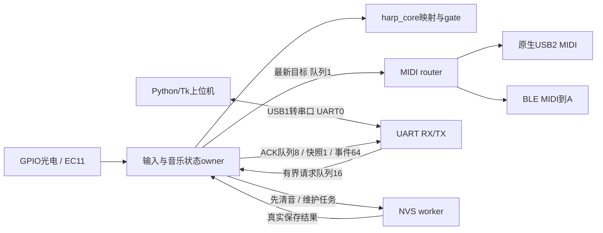
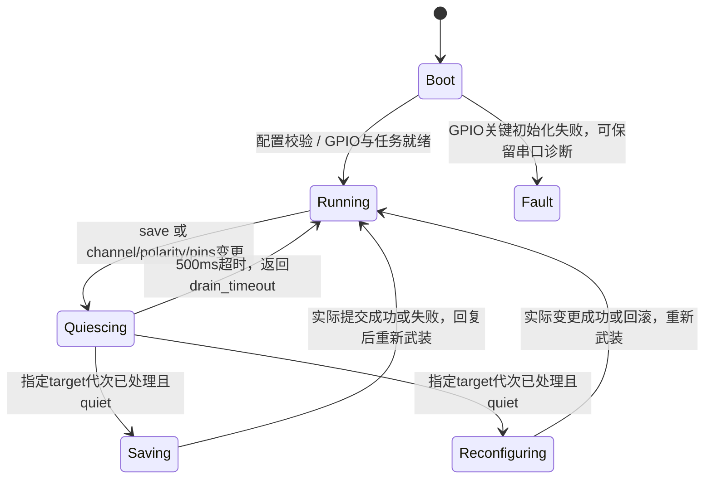

# B 板模块结构、执行生命周期与上板调试

2026-10-28。独立 B 板负责光电/EC11 与 MIDI；A/FPGA/CAD 保持原样。本次在已有输入核心/驱动/传输分层上，进一步把运行调度、配置协议、持久化和电脑调试分开。

## 原结构的评估

原版本已有可主机测试的 `harp_core`，但 `app_main.c` 同时负责NVS、命令应用、GPIO采样、两个MIDI sink及状态输出。即使目标周期是1ms，传输API的锁/排队或显式保存仍可能占住同一循环；配置命令只有“已入队”，上位机无法可靠判断实际生效版本。原生USB与串口虽是不同外设，软件路径仍需要隔离。

## 当前模块

| 模块 | 文件 | 隐藏的工作 |
| --- | --- | --- |
| 输入/音乐核心 | `components/harp_core/` | 去抖、遮光计时、正交编码器、逐路notes/gain、力度曲线、gate、重触发和MIDI状态差异 |
| 配置/协议 | `components/b_control/` | 全量校验、原子patch、严格文本RPC、受限JSON、NVS v3 CRC与v2迁移 |
| 运行生命周期 | `b_control/b_engine.c` | 单owner配置/模型/revision，维护屏障、超时、成功/失败回复，纯C可主机测试 |
| 平台装配 | `main/b_entry.c`、`b_runtime.c` | 启动驱动/任务，GPIO采样、队列与计时统计；入口不再堆业务循环 |
| MIDI输出 | `main/b_router.c` | 独占两个sink，处理拥塞、路由、断连及channel切换后的参数重置 |
| 串口调试 | `main/b_console.c` | 独立RX/TX、4KB收发缓冲、完整行边界、回复优先、JSON输出 |
| 存储 | `main/b_storage.c` | 独占NVS句柄，启动读取与显式异步保存，不自动擦除 |
| 电脑调试台 | `host/b_board_debugger/` | 串口worker、配置草稿/ACK、实时输入、曲线、CSV、离线演示 |

## 调度与资源归属

| 任务 | 优先级 | 触发/频率 | 关键约束 |
| --- | --- | --- | --- |
| `b_input` | 8 | 正常目标1ms | 音乐状态唯一owner；每周期最多2条命令，不打印、不写Flash、不调用USB/BLE发送 |
| `b_midi` | 5 | 新目标唤醒 / 最长1ms重试间隔 | 独占sink影子、发送重试和通道初始化 |
| `b_uart_rx` | 3 | UART数据 / 20ms读取等待 | 最多1024字节/行，超长/非法控制字符整行丢弃 |
| `b_uart_tx` | 2 | ACK / 默认200ms遥测 | 格式化和串口阻塞写仅在此任务，遥测不能挤占ACK队列 |
| `b_store` | 2 | 显式保存事件 | 清音及暂停采样后才提交NVS |

TinyUSB、NimBLE自己的任务仍由原组件管理。没有在缺少实测前强行绑定CPU核；上板后先看统计再决定是否需要固定核/硬件捕获。

采样循环使用绝对周期等待；若已错过计划时隙则跳过，不快速补跑多次假采样。时间戳取实际 `esp_timer`，维护期间清掉上一次采样基准，避免把Flash停顿计成一次长遮光。遥测提供last/max sample gap、max work、missed periods、队列丢弃、非法AB变化及空闲堆内存。

这些是可观察的调度目标和阻塞路径隔离，**不是已经实测的1ms硬实时保证**。Flash/缓存、无线、调度和实物输入波形仍需上板评估。5Hz只是串口显示频率，不是GPIO采样或MIDI发送频率。

## 生命周期

- 音符表、gain、曲线、CC7等普通调音参数可在RUNNING原子应用；无效/冲突配置整批拒绝。
- MIDI channel或硬件相关输入改动先用**旧通道**清音，再应用新配置；router不能用上一次的quiet状态提前放行。channel变更同时清理参数影子，在新channel重新同步CC与Pitch Bend。
- save等待NVS实际返回后才回复。保存失败仍恢复运行并返回storage_error；NVS不可用时RAM设置仍可用。保存开始后，维护不保证持续采样，但不会把暂停时间当作真实脉宽。
- USB或BLE初始化/链路失败按单链路降级，不终止输入；启动队列/任务等关键资源失败仍明确报错。重连沿用epoch和确切pending确认机制。
- 电脑断开不会停止B演奏；主机不盲目重发超时写请求。MCU复位而CH343仍在线时，主机按可观察的uptime回退使旧revision/pending失效并重新回读。

## 调试数据和可调参数

协议详见 [UART调试协议](b-board-debug-protocol.md)，操作详见 [上位机README](../../host/b_board_debugger/README.md)。可调十二路MIDI编号、逐路gain、正向/反向时长→velocity曲线、CC7音量、半音/cent微调、gate、MIDI channel、路由、极性、去抖及编码器绑定/方向。越界有效音高暂时静音，不夹紧到端点造成重叠。

当前实物模拟门限由PR1..PR12调节，见 [电位器说明](b-board-potentiometer-threshold.md)。上位机不虚构其电压读数；先保证受光低/遮光高稳定，再做软件音高与力度标定。

事件含设备时间、完整遮光时长、力度、有效音符、配置revision及synthetic标记，独立有界队列避免最新快照覆盖击弦记录。队满时计数、不阻塞采样；极端拥塞/断连不保证每个中间MIDI状态或调试事件回放。

## 验证范围

真实C核心/配置/协议/engine通过ASAN/UBSAN回归；包含维护旧代次、跨计时回绕、CRC破坏、v2迁移、参数冲突、GPIO失败、倒向曲线和真实正交输入。LSAN在当前ptrace沙箱不支持，测试关闭泄漏探测，地址与未定义行为检查保留。

上位机用真实pyserial PTY做分片/断连测试，Tk用Xvfb创建实际窗口做应用/保存/试奏/CSV/滚动/断开测试。另将上位机实际请求编码器和帧解析器与真实C B协议/engine连通，避免只测试演示替身。ESP-IDF v6.1已实际构建，日志在 `.ai/evidence/lifecycle-debug-20261028/`，当前产物在 `firmware/b_board/artifacts/20261028-lifecycle-debug/`。

本轮没有打开实物串口或烧录，没有改A/FPGA/CAD。桌面演示和行为/协议测试不能代替实际电平、时序、无线环境、接收端声音及Flash故障测试。
