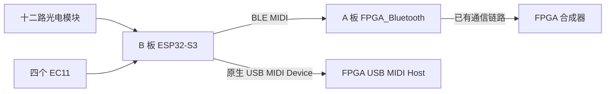

# 激光竖琴 B 板固件

独立 ESP32-S3 / ESP-IDF 项目。B 板负责十二路光电输入、四个 EC11 和 MIDI 发送；主工程原有 ESP32 是 A 板，继续负责它已有的 FPGA 通信。本项目没有把 A 板固件或引脚表复制过来。

模块与任务生命周期见 [结构与调度报告](../../docs/laser_harp/b-board-lifecycle-and-debug.md)，UART桌面调试见 [上位机说明](../../host/b_board_debugger/README.md)，模拟门限见 [电位器说明](../../docs/laser_harp/b-board-potentiometer-threshold.md)。

对接请读 [接口报告](../../docs/laser_harp/b-board-interface-report.md)；其他模块的兼容性与结构问题单独保存在 [额外问题文档](../../docs/laser_harp/b-board-integration-issues.md)，不作为 B 板逻辑交付的阻塞项。



## 按遮光时长演奏

按用户选择，**遮光结束、光束恢复后才发声**。B 板用本次完整有效电平持续时间计算 Note On 的 velocity。遮光期间不预先发送该次 Note On；恢复后音符播放默认 200 ms，再自动发送 Note Off。

默认遮光越短力度越大，映射为线性、四舍五入并限幅：

```text
velocity = round(127 - (clamp(duration_ms, 20, 500) - 20) × 111 / 480)
```

| 有效电平持续时间 | MIDI 力度 |
| --- | --- |
| ≤20 ms | 127 |
| 100 ms | 109 |
| 260 ms | 72 |
| ≥500 ms | 16 |

这里用 Note On 的 velocity 表达每个音符的力度/音量，ENC2 的 CC7 保留为独立总音量。超过端点的有效遮光时长在端点限幅，不产生 velocity=0；短于去抖稳定时间的脉冲仍会被滤除。默认曲线为 `velocity=[20,500,127,16]`，有效 NVS 保存值仍优先，启动日志和 `get` 回读可核实实际端点。

十二路独立计时、独立力度、独立关音定时，可同时发音。同一路在旧音结束前再次完成遮光，会先发送旧音 Note Off，再用新力度发送 Note On。ENC1 移调也会先释放旧音高，再按新音高重发尚未结束的音符。

默认 1 ms 扫描，激光有效/无效两侧均需稳定 2 ms；时长取最终通过去抖的原始边沿之间的时间差，不把两次去抖等待算成额外遮光。有效脉冲短于稳定确认时间会被滤除。计时支持 32 位毫秒回绕；这属于毫秒级软件测量，不是硬件脉宽捕获。上电已遮光或执行 Panic 时仍遮光的通道，须先恢复光照，再完成一次新的遮光，才允许触发。

力度是每次 Note On 的 velocity；ENC2 的 CC7 是通道音量，两者各自保留。默认报文通道编号 1（常用叫法通道 2）、第一路音符 60（本项目按 C4 命名），十二路对应 60–71。上位机可独立设置十二个互不重复的音符和25–200%力度gain；曲线两个力度端点可倒向，移调越界的通道暂时静音。

## MIDI 通道选择合成引擎

激光竖琴 ESP32 的默认发送通道为 **MIDI 报文中的通道编号 1（0～15 编号）**，即常用叫法的 **通道 2（1～16）**。Kconfig、RPC/JSON 和 NVS 配置沿用1～16，因此 `sdkconfig.defaults` 显式设为 `CONFIG_B_MIDI_CHANNEL=2`，`get` 回读为 `channel=2`。十二根弦共用这个发送通道，通过 MIDI Note 区分弦和音高；网页 OUT01～OUT12、原理图 D1～D12 都是光敏通道编号。

Note On、Note Off、编码器 CC7/CC74/CC71、调音 Pitch Bend 和 Panic 的 CC120/CC123 均使用同一 MIDI 通道。USB MIDI 与 BLE MIDI 保留相同通道，由接收端按通道编号选择合成引擎。默认状态字节低四位为 1：Note On 为 `0x91`、Note Off 为 `0x81`、CC 为 `0xB1`、Pitch Bend 为 `0xE1`。

仍可通过既有配置将常用叫法的通道设为 1～16，对应报文编号0～15。有效 NVS 保存值优先于构建默认，启动日志同时打印实际 `MIDI engine channel ID` 和常用通道号；`rpc 1 -1 get` 的 `config.channel` 使用常用通道号。若旧 NVS 保存了 `channel=1`，其报文编号仍为0，需要显式应用 `channel=2` 才能采用本次默认编号；本次不自动覆盖保存值。此约定不指定接收端各编号对应哪一种合成算法，具体引擎映射由接收端实现。

## GPIO 与接口

2026-10-30 已按用户最终确认的第4版对照更新构建默认值。下表按 OUT1～OUT12 顺序排列；原图十项旧IO文字不再用作GPIO配置依据。四组EC11也已写入Kconfig与sdkconfig.defaults；运行时若加载了NVS配置，须通过get/status核对实际绑定。

| 激光通道 | 1 | 2 | 3 | 4 | 5 | 6 | 7 | 8 | 9 | 10 | 11 | 12 |
| --- | --- | --- | --- | --- | --- | --- | --- | --- | --- | --- | --- | --- |
| GPIO | 4 | 5 | 46 | 6 | 18 | 7 | 9 | 15 | 10 | 16 | 11 | 17 |
| 默认 MIDI Note | 60 | 61 | 62 | 63 | 64 | 65 | 66 | 67 | 68 | 69 | 70 | 71 |

原理图审查后，光电输入默认高电平表示遮光、低电平表示受光；`harp polarity 1` 为该默认，`harp polarity 0` 可用于反相外部模块。输入启用内部上拉。2026-10-30自然光遮挡/放开采集176.61秒仍为raw0xFFF，未观察到输入翻转，实物遮光触发未确认；详见 [IO 接收逻辑审查](../../docs/laser_harp/b-board-io-review.md)。若曾保存旧 `polarity=0` 到 NVS，需显式修改并重新保存。

**已撤回“光敏与编码器六项实际硬件GPIO重叠”的结论。** 按同一用户J1/J2图换算，两组输入共24个唯一GPIO、不占USB19/20。用户已逐项确认全部十二条编码器GPIO，A/B/SW为 `(13,14,12)`、`(40,39,41)`、`(47,21,38)`、`(2,42,1)`；ENC_A4=GPIO2，GPIO12仅用于ENC_SW1。此前六项数字交集混用了光敏旧IO标签与编码器参考图换算，不能据此判硬件重叠。本次已同步光敏数组、GPIO校验与四组编码器构建默认值；24路互不重复，见 [更正后版本交接说明](../../docs/laser_harp/ec11-gpio-handoff-20261030/README.md)。

当前YD-S3校验允许的编码器GPIO为 `1,2,8,12,13,14,21,38,39,40,41,42,47`。每只编码器必须同时配置 A/B/SW 或同时设置 `-1 -1 -1`；拒绝重复引脚以及激光、USB、UART、存储器、启动绑带和板载 RGB 所占用引脚。若实际电路使用了此配置保留的引脚，先核实板型和引脚用途，调整 B 板专用配置，不能绕过校验直接套用排针数字。

- **原生 USB2**：GPIO19 D−、GPIO20 D+，枚举为 `Laser Harp B` USB MIDI Device，连接 FPGA 的 USB MIDI Host。
- **USB1 / CH343P**：UART0 日志和命令行，115200 baud。该串口桥自身不会枚举为 USB MIDI。
- **本轮实物 UART 连接**：用户使用 FT232R（A5069RR4）接入同一 UART0，电脑端为 `/dev/ttyUSB0`，115200。2026-10-29 已通过 ping/get/status 和软件试奏验收；本机需临时加载 `ftdi_sio`（既有自动加载黑名单未修改）。原生USB2同时保持MIDI。
- 电路中只有供电/CC 的 Type-C 符号不能替代原生 USB 数据口。

## 编码器定义

| 编码器 | 旋转 | 按键 |
| --- | --- | --- |
| ENC1 / SW4 | 半音移调，−24…+24 | 微调降低 1 cent |
| ENC2 / SW5 | CC7 通道音量，0…127 | 微调升高 1 cent |
| ENC3 / SW6 | CC74 滤波截止频率，0…127 | 截止复位为 127，共振复位为 0 |
| ENC4 / SW7 | CC71 共振，0…127 | Panic：清音，当前遮光须重新释放后再触发 |

按键稳定确认 20 ms，每次按下执行一次，无长按连发。正交解码默认每档 2 个合法状态边沿，支持 4 边沿和逐旋钮反向位掩码；非法 AB 双位跳变会清掉未完成的半步并计数。

微调范围 ±100 cents，通过 14 位 Pitch Bend 发送，换算假设接收端范围为 ±2 半音。当前 FPGA 源码中 FM 符合该范围；减法音源默认范围为 2，但 A 的模板可以改变它；KS 路径当前没有启用 Pitch Bend。故不能声称两个调音按键对所有音源都已生效。本项目不改变 A/FPGA 的参数映射；CC74/71 的听感也取决于选用音源。

## USB 与蓝牙发送

B 是 BLE central，主动扫描名称 `FPGA_Bluetooth`。A 将名称放在 Scan Response 中，因此这里启用主动扫描；连接后继续验证 MIDI 服务与特征 UUID，使用特征的 Write Without Response 属性发送。

```text
Service:        03B80E5A-EDE8-4B33-A751-6CE34EC4C700
Characteristic: 7772E5DB-3868-4112-A1A9-F2669D106BF3
BLE packet:     timestamp header + timestamp low + 完整 MIDI status/data
USB packet:     cable 0 / CIN + MIDI status/data，四字节事件包
```

不需要为了运行 B 的蓝牙功能修改当前 A 源码。A 必须已烧录并运行对应 BLE MIDI peripheral 服务；本次只读源码接口及解帧器，没有核实实物烧录版本。B 不广播 BLE MIDI peripheral 服务，不需要在 A 上扫描 B。

默认 `auto`：USB 已枚举且未挂起时选择 USB，否则选择已就绪的 BLE。也支持 `usb`、`ble`、`both`。两个 sink 分别跟踪已被发送 API 接受的音符和参数，拥塞时保留待确认的同一报文，优先释放旧音符。连接换代后先发送 CC120/123、控制器与弯音状态，再恢复仍在 gate 内的音符。

切路时先把旧路由的关音提交成功，再向新路由重放状态。**发送 API 接受不等于远端实际消费确认**；BLE 无响应写尤其如此。当前 A/FPGA 源码分别使用 USB source 0、BLE source 2，并按 source/channel/note 管理关音，但切路仍可能短暂重触发或叠音。演奏时可固定 `ble` 或 `usb`；`both` 只在确实需要双输出时使用。链路丢失期间的短音不做无限排队，恢复后只重放当前仍有效状态，不能保证链路断开时每个演奏事件都被接收。

## 串口设置

通过 USB1 / CH343P 打开115200 baud UART终端，按行发送命令；人工终端可打开本地回显。专属UART RX/TX任务不做ANSI终端探测；原harp指令继续可用，回复为`@B `前缀JSON。推荐使用 [桌面调试台](../../host/b_board_debugger/README.md)。以下命令用于用户后续上板，本次没有打开实物串口。

```text
harp get
harp channel
harp channel 1
harp status
harp velocity 20 500 127 16
harp gate 200
harp polarity 1
harp route ble
harp transpose 0
harp volume 100
harp fine 0
harp panic
harp save
```

`harp channel` 查询当前通道；`harp channel <0..15>` 按报文编号选择全局发送通道，例如 `harp channel 1` 使用 Note On `0x91`，十二根弦和编码器控制消息都使用此编号。切换先等待旧通道清音，再应用新通道，成功回复后生效；先保存在 RAM，需要跨重启保留时再显式 `harp save`。配置回复同时包含顶层 `midi_channel_id`（0～15）与 `config.channel`（1～16）；原有 `rpc ... apply channel=2` 仍表示报文编号1。

桌面调试台的“力度曲线 / 演奏参数”提供“MIDI 通道编号 (0–15)”选择，同时显示已应用值、草稿值及常用通道号；点击“应用草稿”并等待设备ACK。JSON文件/NVS中的 `channel` 继续使用1～16。终端和桌面程序共用同一UART，切换工具前先释放已有监控占用。

`harp velocity` 参数依次为最小/最大遮光时长（ms）、短/长时长对应的两个力度端点；要求 `1 ≤ min_ms < max_ms ≤ 60000`，两个力度各为1–127，允许长时长对应更小力度。`harp gate` 设置恢复光照后的发声长度 10–5000 ms，不会改变已经发出的音符力度。设置影响后续完成的遮光事件；既有音符保留触发时的力度和截止时刻。

绑定编码器的语法为 `harp encpins <1..4> <A实际GPIO> <B实际GPIO> <SW实际GPIO>`，解绑例如 `harp encpins 1 -1 -1 -1`。不要把 H1/H2 针号直接填入这个命令。

`harp status` 返回JSON状态：原始/遮光/发声位图、最近时长/力度/hits、有效音符、链路与调度计数。完整配置使用`rpc 1 -1 get`，上位机使用带id/revision的原子apply、stream和save。扫描任务只发布快照，UART TX任务负责格式化和发送，协议见 [v1文档](../../docs/laser_harp/b-board-debug-protocol.md)。

参数默认仅保存在 RAM；`harp save` 显式保存到 B 板自己的 NVS namespace `harp_b`，重启优先使用验证通过的保存值。NVS 初始化失败时不会擦除原有数据。保存先清音、等待router处理指定目标代次，再进入维护并由存储任务写入，真实提交后才ACK；恢复时重新武装，不把维护时间当作遮光。新224字节v3配置有版本/长度/CRC，并可读取旧100字节v2。**在演奏间隙保存**，1ms是正常扫描目标，维护期间不承诺硬实时。

## 构建和测试

已验证工具版本：ESP-IDF **v6.1**（`fff9895c82d744c7237be8847347bdd1b07c6643`），esp_tinyusb **2.4.0**，tinyusb **0.21.0~2**。组件版本/哈希固定于 `dependencies.lock`。2026-10-29 连接实物后，ROM 查询确认 ESP32-S3 revision v0.2、16 MB Flash，芯片报告内置8 MB PSRAM。当前配置采用16 MB Flash、DIO、单 factory 分区（`0x10000..0x1000000`）；NVS和PHY地址保持不变。输入/MIDI逻辑不依赖外部RAM，继续不启用PSRAM；报告的容量不等于已完成PSRAM读写测试。此前4 MB配置是未连接实物时的兼容构建。

```bash
cd /home/ice/文档/ChatGPT/激光竖琴
./firmware/b_board/test_host.sh
./firmware/b_board/build.sh
./firmware/b_board/build.sh menuconfig
```

`menuconfig` → `Laser Harp B board` 可配置通道、音符基准、力度曲线、gate、极性、编码器引脚/方向和 A 的名称。交叉参数如时间下限 ≥ 上限会在启动时被拒绝。无有效 NVS 时使用构建默认；修改过构建默认后，已有有效 NVS 仍优先。

构建脚本只构建，不烧录。默认 SDK 为 `/home/ice/esp/esp-idf-v6.1`；可通过 `B_IDF_PATH` 覆盖。默认输出为 `/home/ice/.cache/laser-harp-b/build`，可通过 `B_BUILD_DIR` 覆盖为另一个英文路径。首次 CMake/Ninja 构建把中文路径下的 specs 文件参数损坏，因此仅移动构建输出，源码仍在本仓库；每次显式 reconfigure 以刷新 Kconfig。未修改 SDK 或工具链。

主机测试使用 C11、`-Wall -Wextra -Werror`、AddressSanitizer、UndefinedBehaviorSanitizer。兼容测试直接只读编译 A 工程现有 `main/ble_midi_unframer.c`，没有复制 A 源码；可用 `A_BOARD_ROOT` 指定该工程。找不到 A 解帧器时测试脚本返回失败，避免静默跳过兼容验证。

源码结构：`components/harp_core`负责输入/音乐与发送状态差异；`components/b_control`负责配置、协议、CRC持久化和可测试生命周期；`main/b_entry.c`装配`b_runtime`输入owner，`b_router`/`b_console`/`b_storage`分别处理MIDI/UART/Flash。pinmap已迁入b_control，驱动仍在board_io/usb_midi/ble_midi_tx。

本轮C回归覆盖原15组、映射/gain/倒向曲线、协议/配置/维护/CRC迁移；9次跨语言事务用上位机实际编码器/帧解析器对接真实C核心；54包A解帧兼容仍通过。桌面程序27项含PTY和真实Tk窗口测试通过。当前ptrace沙箱关闭LSAN，ASAN/UBSAN继续启用。

USB 描述符结构参考本机 ESP-IDF 的 MIT 许可 `tusb_midi` 示例，版权声明与许可见 [THIRD_PARTY_NOTICES.md](THIRD_PARTY_NOTICES.md)。文档索引没有明确覆盖 v6.1，API 以本机 v6.1 官方源码、头文件和实际编译为准。

## 实物验证状态

2026-10-29 已在实物B板完成16 MB Flash备份、烧录、三镜像独立校验及USB MIDI枚举；FT232R UART读取运行状态成功，100 ms软件试奏实际输出MIDI60/力度35的Note On与自动Note Off。证据在 `.ai/evidence/esp32-first-flash-20261029/acceptance.json`（项目根目录）。

实际编码器MCU GPIO仍未绑定；当前12路原始输入均高，真实输入电平/极性、通道顺序与光学触发尚未验收。BLE连接/断线/延迟、A实际固件版本及各音源听感仍需联调；报告的8 MB PSRAM未启用或读写测试。软件试奏不代替物理外设验证。本轮仅烧录B，未修改或烧录A/FPGA/CAD。
