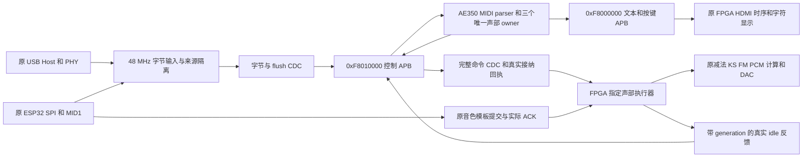

# AE350 MIDI 控制集成（2026-10-28）

本次在 D 盘现有独立实验目录增加 `ethereal_cloud_tone.gprj`，保留已验收的 `ae350_menu_lab.gprj` 及其 AE350 镜像。主仓库只读。输入基线记录在 `provenance/control_integration_baseline_20261028T054506Z`，包含主仓库实际工作树的 251 项文件及菜单、固件、迁移候选的恢复副本。

## 归属与时钟

- AE350 是唯一 MIDI 字节解析者和演奏声部 allocator；FPGA 执行器只接收指定的 engine/voice/generation，不查找可用声部或匹配 NoteOff。ESP32 继续拥有 Web/BLE 连接、模板编译和单一 SPI 事务调度。
- 维持核心 800 MHz、AHB/APB/DTCM 50 MHz 和专用 PLL_R[0]/CLKOUT1。原输入/控制 48 MHz、减法计算时钟、KS、FM、音频串行时钟保持原配置。声音请求、标签及 PCM 输出留在 FPGA。
- 48↔50 MHz 的字节、flush、声音命令、idle 都传完整载荷并有背压。命令 ACK 要在目标执行器持久接纳后返回，不在源侧 mailbox 捕获时提前返回。所有者 reset 与 CPU/控制链协同，避免独立复位造成旧命令重放。
- 保留 USB D+/D-、PMOD1/J8 SPI、DAC、HDMI、UART 和 WS2812 的现有球脚。2026-11-02主控制工程移除旧引擎切换开关，AB13/Y12释放；AA13保持系统复位/GSR，旧菜单独立工程保持原按键。

## 固定接口

- 原 `control_event.h` 的五字声音命令：W0 engine/voice/kind，W1 pitch/参数，W2 note/velocity/volume/pan，W3 source/channel，GEN 32 位。APB COMMIT 非零 sequence，单个固件 in-flight owner 等匹配 ACK。
- 原控制 APB ABI 保留。新增 `0x70 BACKEND_STATUS`：bit2:0 为各引擎真实 ready，bit8 为控制链在线；其余诊断字段在实现时列明。旧菜单 ABI 不变。
- 控制 APB 增加 flush POP 完成 sideband（mask/seq）；固件先清 parser、controller、owner 并排空清音命令，才 POP flush。输入 CDC 在完成返回前阻止对应来源恢复；断线与异常必须取消上游未接收槽，不能只清 APB FIFO。
- 新 owner 开关 `ENABLE_AE350_VOICE_OWNER` 默认 0；仅控制实验开启。声音执行器支持可撤销模板 WAIT，OFF/KILL 可以取消尚未发声的 ON。真实 idle 必须带当时占用 generation，迟到反馈不释放新占用。

## 并行文件范围

- 输入专项：D 盘 `src/control_input/`、`control_migration/rtl/ae350_ingress*.sv` 及对应测试/文档。
- 音源执行专项：D 盘 `src/synthesizers/`、`control_migration/rtl/ae350_voice_backend*.sv` 及对应测试/文档。
- 固件驱动专项：`firmware/control_service.[ch]` 和独立 host MMIO 测试。
- 父代理：共享 ABI 与声部 C 补全、`rtl/board/synth_system.sv`、控制 APB、跨域命令/反馈、顶层、界面、构建输入/约束、集成验证与项目记录。

## 验收与构建

覆盖 USB/Web/BLE 独立 Running Status、实时消息穿插、NoteOn=0、重复音符、延音、抢占、弯音、清音、背压、断线 flush、旧代 idle、模板提交中 OFF，以及真实 FPGA PCM 非零与停止。host MMIO 验证固件寄存器访问和 ACK 顺序；RTL 集成用实际执行器和 PCM 核，不把 BFM 结果称为受保护 AE350 核执行。

相关验证通过后自动启动官方综合，后台日志独立显示，10 分钟后只检查一次；成功且输入无漂移时启动布局布线和日志窗口，然后结束本轮。没有本轮硬件写入动作；后续实板验收与当前仿真结果分别记录。
