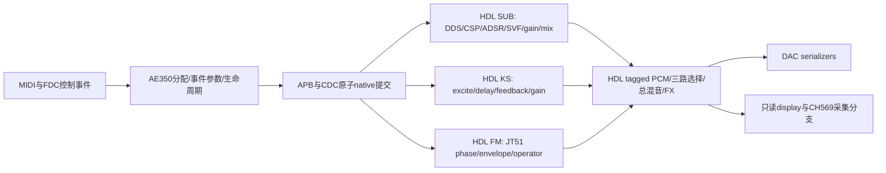

# 上游缺陷同步与实时音频边界核查（2026-11-02）

当前结论：修复静态 partial cutoff key tracking 与 RELEASE 分配顺序；实际启用的 SUB、KS、FM、并行输出与后处理均在 HDL 计算实时 PCM。AE350 保留事件级控制与参数编译。定向联合仿真未复现“冷启动首音没有起音”；实板原症状仍未验收。

唯一生产工程为 `/media/ice/D;/PROJECT_improve/ae350_fpga_menu_lab_20261028`，清单 `ethereal_cloud_tone.gprj`，顶层 `rtl/top/control_lab_top.sv`，器件 `GW5AST-LV138PG484AC1/I0`。该目录 Git 为 unborn main，生产源码主要 untracked；用实际文件与 SHA256 前像评审，不以空 Git diff 表示干净。本次不接管另一 LAB、不恢复暂停任务、不写任何设备、不 stage/commit/push。

## 上游范围及处理

只读参考树实际 HEAD 为 `2409560e66754f04b737c7f1ae68223422d01cc9`，工作树干净。该树使用 CSP2；本工程保持原 CSP ISA、寄存器与单位，不做 CSP2 整套迁移。GitHub API 本次 HTTP 403 rate limit；已通过公开 PR/commit 页面核对下列适用语义，并读固定参考树的 `app/main/render.cpp`、`voice_alloc.cpp`。不将新功能或历史撤回方案视为必须回移的修复。

| 上游记录 | 本工程实际状态与本轮处理 | 证据边界 |
| --- | --- | --- |
| PR214 (historical source recorded in the retained archive) 的静态 tune/unison tracking | **本轮修复**。原 C packet 的 oscillator pitch 包含 partial offset，cutoff 却只按 note 计算；RTL 又用共同 cutoff 覆盖各元素。现在按完整 signed static pitch 计算每 partial cutoff，以完整 context 送入原参数 RAM，运行时消费它。 | note60、K64、offset 0/+1024/−1024 得 pitch5120/6144/4096、cutoff5632/6656/4608。C363 checks 与真实 RAM/runtime1096 checks。 |
| PR214 的 pitch-LFO→cutoff 部分 | **不回移**。最新参考 `render.cpp::lfo/channel_sound` 分开 pitch LFO 与 cutoff destination；只跟踪静态 tune/spread。 | 保留当前显式路由、bend×K 与 touch 逻辑；不凭早期 PR 标题扩大调制路由。 |
| PR270 (historical source recorded in the retained archive) 的最早释放优先 | **本轮修复**。原 RELEASE 与 HELD 都比较 Note On age；新增真实 backend occupancy 的 `released_at`。正常释放首次记序；held-steal 的旧 OFF 真 ACK 也补记；新 ON 真 ACK 才清零。 | 三引擎 public VM API823 checks，包括 sustain、重复释放、不接受 replacement 的取消、旧 OFF ACK 后取消、旧 generation feedback 和 backpressure 原子性。 |
| 94d75c4 (historical source recorded in the retained archive) / PR155 | 原 `adsr.sv` 已含 REL→ATT 初值清零，保留。 | 本轮真实 CSP/ADSR 检查 cold/repeat/held/release；fast 首步82534，抢占两种情况都从同一初值开始。 |
| PR283 (historical source recorded in the retained archive) | CSP2 的软件写 stage/不同寄存器布局及从 tail level 继续 Attack，**不是可直接套入本 CSP 的漏合补丁**。 | 当前 NEW→WAIT、prepared、pass count 与 HDL gate/ADSR 协作已测试；不将“未合PR283”等同首音缺陷。 |
| PR116 (historical source recorded in the retained archive) | `PIPE_DRAIN=5`、最终 state/writeback 后才增加 pass_count 已存在，保留。 | 本轮联合仿真执行真实 sequencer；未重新声称全输入形式证明。 |
| PR119 (historical source recorded in the retained archive)、PR122 (historical source recorded in the retained archive) | TPT SVF、四状态±96限幅、关键38bit中间guard、双滤波共振输入衰减已存在，保留。 | 对应 RTL、tan 表、官方 GW5A DSP 源 SHA 保持；本轮不是全频率稳定性或资源优化验收。 |
| PR161 (historical source recorded in the retained archive)、#164、PR148 (historical source recorded in the retained archive) | PR161 关闭未合；#164 未核得确定落地修复；PR148 mailbox hardening 在其历史中撤回。**不复制这些尝试。** | 不能用未合 fade 或已撤回寄存器替换本工程较强的真实 ACK/idle 机制。 |

## 实际职责与消费者

顶层明确启用 SUB/KS/FM、AE350 owner、request-driven PCM、并行三路输出、reverb；ADDITIVE/FLUTE 关闭、KS timbre扩展关闭、output tilt关闭。FM 走 `fm_engine.g_prepared`，不能把未启用的旧 `fm_audio_resampler` 分支当当前必经路径。reverb 模块启用而默认 wet/damp 为0；允许配置的计算仍由 HDL 执行。

| 路径 | AE350 的生产调用链/输出 | 真正逐样本消费者与状态所有者 |
| --- | --- | --- |
| MIDI/生命周期 | `control_main → cs_poll → cr_pump → vm_submit`；allocator、source/channel路由、sustain、generation、真实 ACK/idle 归属 | `control_link_apb → command CDC/router → engine native backend`；命令不是 PCM payload。 |
| SUB 静态参数 | `cf_begin → sub_job` 编译 note/tune/spread、bend、K、touch、velocity depth、系数、原子 context | `ae350_voice_backend_sub → element_param_bank → element_pipeline.u_renderer`；静态提交后独立按 PCM request 执行。 |
| SUB 实时合成 | C不循环生成样本、不推进振荡器/滤波/包络状态 | `dds_antialias_oscillator` 的 phase/wave；`csp` 的 LFO 与 `adsr` recurrence；`svf_tpt` 及四状态写回；`stereo_gain`、`stereo_mixer`、`master_limiter`。 |
| KS | `cf_begin → ks_job` 提交 length/tuning/loss/amplitude/pan/seed；允许事件级查表和整数换算 | `ae350_voice_backend_ks → physical_model_top` 的 excite/noise、delay ring、反馈、dispersion、release/fade、逐样本 gain/mix/limit。 |
| FM/FDC | `fm_job/fm_pairs` 准备 KC/KF、TL、pan、operator pair；FDC raw→校准/映射→source3 VM事件，心跳和增益为控制参数 | `jt51_prepared_audio_backend → jt51_native96_top → jt51_*` 推进 operator phase/envelope/反馈/混音，HDL 发布 PCM；FDC逐样本乘法/存活静音在 HDL。 |
| 输出/旁路/后处理 | C或SPI可请求 route、mute、wet、damp 等控制，不读改写必经 PCM | `pcm_request_audio → pcm_request_channel → pcm_three_output_stage` 按 tag 收齐三源、选择solo或total、HDL求和；`pcm_frame_effect`/reverb、可选tilt及测试音；三套 `pt8211_tx`。raw/solo/bypass也不经过C样本算法。 |
| 观测/传输 | UI、AE350状态寄存器、ESP控制与CH569/USB传输是观察或控制 | `synth_system` 的 `scope_pcm_*` 向 `pcm_hspi_monitor_tx` 和 display held-bus CDC 分叉；display/FFT/10kHz键盘图形不回送音频发送器，USB采集不是软件合成。 |

证据是生产 C 编译源、APB 字段与上述实例连接/消费者，未按文件名或“C里有乘法”判断。未发现 C 软件生成/修改实时 PCM 的必经计算，因此不进行无据的大范围 MCU→HDL 搬迁。振荡器、ADSR/LFO 实时递推、SVF 状态、逐样本乘法/混音/限幅与后处理保留 HDL。

## 首音定向验证与限制

`sim/tb/upstream_first_note_test.sv` 仅增加观察端口；实际 host C parser/VM/compiler 的生产包经真实 native ACK 驱动 SUB32voices/256elements、CSP、抗混叠 DDS、TPT SVF、官方 GW5A RAM/DSP、gain/mix/limiter。时钟每样本768计算拍，约96008Hz。真实硬核 AE350、APB/实际MIDI时序、共享FX、DAC模拟输出与实板听音不在此仿真边界内。

最终结果见 `sim/results/upstream_audio_boundary_20261102/first_note_final/`，58项检查PASS。frame为测试事件提交后的样本帧；“非零PCM”是数字分辨率测量，不等于可闻阈值。

| 用例 | gate首次高 | 包络首次递推 | 首步level | 首次非零PCM | 含义 |
| --- | --- | --- | --- | --- | --- |
| canonical默认 | 1 | 2 | 1996 | 198（约2.06ms） | 未缺首音，较慢Attack及后续增益/滤波影响可见输出。 |
| fast kA253952 | 1 | 2 | 82534 | 49（约0.51ms） | 减小Attack时间改变PCM显现，不改变最初gate/包络时刻。 |
| slow kA1 | 1 | 2 | 1 | 298（约3.10ms） | 初始极小包络也有递推，初期输出很弱。 |
| dark低cutoff | 1 | 2 | 82534 | 336（约3.50ms） | fast包络已启动而输出被滤波减弱；不能等同包络没触发。 |

每个用例还在真实 KILL/idle 后重新按相同 MIDI note。占满32声部后另测 held-steal 与释放41再释放40的release reuse：实际选择voice0/voice1，均观察到WAIT gate低，再进入HELD，首个Attack更新82534，与从零首步一致。没有改用户已记录的WAIT静音设计。

两种复用在局部transition附近可见较大PCM样本差，trace完整保留；总混音中仍有其他声部，尚未单变量隔离“旧槽直接静音”相对自然波形/新音/filter历史各自的贡献。**不能据最大相邻差宣称已定位可闻click根因或已消除click。** 原“首次按键没有明显起音”仍需实际输入/硬核调度和板上音频验证，本轮不烧录。

## 回归、前像与构建交接

- `host_final/result.json`：ASan/UBSan；release823、partial363、extended VM、SUB_PATCH1 82、FDC-on9377/FDC-off119及FM compiler PASS。较强的真实 generation/idle、FDC source3 和取消语义保留。
- `native_final/result.json`：1096 checks；完整新context、40次RAM写、旧90bit fallback、成功legacy SCALARS改cutoff、新格式SCALARS保留partial base、HOT不重触发、畸形/缺片拒绝。
- 两次生产修复均有旧行为失败日志；复核发现的两个P2亦先以新回归失败再修复，`host_review_red`/`native_review_red`原样保留。
- 旧 `tests/ae350/test_control_compile.c` 在完全原前像也因历史默认音色fixture失败line44，见 `preexisting-compiler-legacy.log`；不修改生产默认音色去迎合旧fixture，不把此历史测试算PASS。
- `baseline.tar.gz` 保存712路径、逐member SHA核验；`production-before.json` 是337个实际构建输入；必要额外文档/测试前像在 `contract-test-preimages.tar.gz`。
- `itcm_final/result.json`：RV32IM/ILP32 soft-float实际链接、无未定义符号，55140B；保留64KiB ITCM与4KiB stack reserve。官方IPC导入生成的新V/VO按原样使用；32 SP位平面重建64KiB与binary补零逐字节0diff；除ITCM初始化与生成日期外，plaintext VO的非ITCM tokens、配置保持。保护V密文不可字节比较，也未解读。
- 所有仿真保留原始warning/log，不将`-Wno-fatal`的功能仿真当“无warning lint”或官方时序证明。重要结果只在本任务目录，临时文件只在D盘指定scratch；清理清单与最终输入差异见同目录交接JSON。
- 新官方综合与后续队列PnR另记 `continuation.json`；只接受该次run、退出状态、输入与官方产物身份一致的结果。PnR启动和独立viewer确认后结束当轮，不自动继续STA/设备工作。
