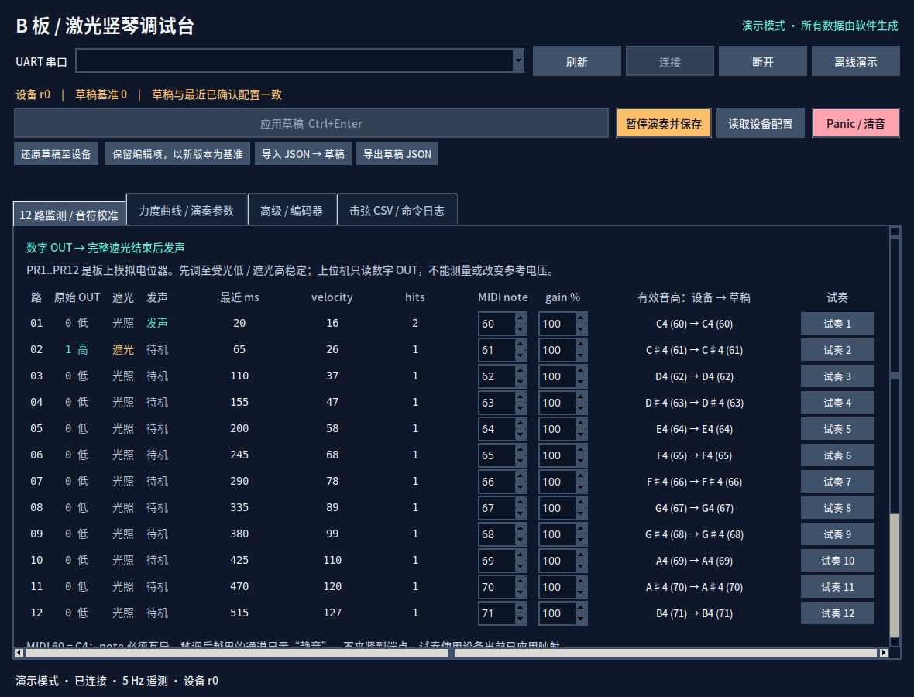

# B 板桌面调试台

独立激光输入 B 板的中文 Python / Tk 桌面程序。调试使用 **USB1 / CH343 的 UART0，115200 baud**；原生 USB2 保持 MIDI。实现契约为 [`docs/b-board-debug-protocol.md`](../../docs/laser_harp/b-board-debug-protocol.md)。本程序不包含固件烧录功能。



## 运行

在工程根目录执行：

```bash
./host/b_board_debugger/run.sh --demo
```

或：

```bash
python3 -m host.b_board_debugger --demo
```

`run.sh` 可从其他工作目录用完整路径调用。真实 UART 调试去掉 `--demo`，点击“刷新”，明确选择 CH343 / UART 串口，再点击“连接”。启动不会自动枚举或打开串口；演示也不会查找实物。

本机已验证环境：Ubuntu、Python 3.12.3、Tk 8.6、pyserial 3.5。Tkinter 由系统 Python 提供，唯一 PyPI 运行依赖列在 `requirements.txt`；现有环境无需安装依赖。未增加或修改全局包。Pillow 仅用于交付前截图，不是程序依赖。

Windows 的 Python / Tk / pyserial 原则上可作为移植方向，串口选择会显示系统枚举到的 COM 端口；本轮没有 Windows 验证，也未制作安装包。

## 网页只读监控与断电重连

在工程根目录运行（本机实际调试口为 FT232R A5069RR4）：

```bash
python3 -m host.b_board_debugger.web_monitor \
  --port /dev/serial/by-id/usb-FTDI_FT232R_USB_UART_A5069RR4-if00-port0
```

打开 <http://127.0.0.1:8765/>。网页服务运行在电脑上，UART采集由同一进程中的唯一线程负责；ESP32断电、USB拔出时服务继续运行，每秒尝试同一个稳定设备路径，重新连接后自动查询配置、状态并开启200ms遥测。MCU单独重启时根据uptime回退重新握手，击弦序号从新会话计数；正常uint32时间回绕不当成重启。v1协议没有boot id，完全隐藏在两帧之间的重启不能保证识别。

连接中断时明确显示等待重连及缓存数据；“暂停画面”只暂停显示，“停止监控并释放串口”会关闭串口并停止自动重试，点击“恢复串口监控”继续。使用其他串口终端、桌面程序或烧录前先停止网页监控。只发送ping/get/status/stream，不apply/save/strike，也不自动烧录。打开UART仍可能触发开发板复位。

服务默认没有4小时退出限制，关闭浏览器不会停止服务；电脑重启或服务退出后需重新运行上述命令。默认会话记录在`.ai/evidence/web-monitor-时间戳/`，也可用`--output 目录`指定。`process.json`记录服务/串口owner PID，`live.json`保存状态及最近100条事件，CSV导出本次服务保留的最多4096条事件。`frames.jsonl`按4MiB轮换，最多保留4份。仅监听127.0.0.1，不对局域网开放。

## 调音与配置

- **先调板上 PR1..PR12。** PR 是光电比较器参考电压电位器；MCU 只读取数字 OUT。先调到受光低、遮光高稳定，再在程序里标定遮光时长到力度、音高及 CC7。界面不提供光强或模拟门限滑块，也不虚构电压读数。
- “12 路监测 / 音符校准”显示 raw OUT、遮光、发声、最近时长、velocity、hits。逐路编辑互不重复的 MIDI note 0..127 与 gain 25..200%。有效音高显示设备值和草稿预览；移调越界显示静音。
- “力度曲线 / 演奏参数”编辑时间范围和两个力度端点，默认短遮光更响：20 ms→127、500 ms→16，100 ms→109、260 ms→72；完整默认值为 `[20,500,127,16]`。虚线为全局曲线，实线为选定通道 gain 后的预览。**velocity 是单次 Note On 力度，CC7 是独立通道音量**。时间范围不是模拟阈值。连接实板后以设备回读配置为准，已保存的旧曲线不会被主机默认值自动覆盖。
- 可编辑 MIDI 通道编号、gate、transpose、fine cents、route、CC74 cutoff、CC71 resonance、polarity、debounce。界面的“MIDI 通道编号 (0–15)”直接输入报文编号，默认填1；旁边同时显示已应用值、草稿值和常用通道号。点击“应用草稿”并收到ACK后生效，切通道先清音；跨重启保留时再点击保存。微调遵循设备既有接收端 ±2 半音换算约定。
- “高级 / 编码器”提供 4×3 A/B/SW GPIO、逐编码器反向及每步 2/4 edges。默认每组 `-1,-1,-1` 禁用。B profile 白名单与固件 `b_pinmap.c` 一致；不按排针位置猜 MCU GPIO。混合 -1、重复、保留脚及不完整组会被拒绝，最终仍由固件验证。

输入框可使用键盘与上下箭头；`Ctrl+Enter` 应用草稿。四个页签都可滚动，缩小窗口时支持横向和纵向滚动；Tab 键进入的控件会滚到可见区域。原始/遮光/发声同时使用文字和颜色表示状态。

JSON配置文件、RPC的 `config.channel` 和NVS保持常用通道号1～16，界面负责与报文编号0～15转换，导入导出不会重复减1。普通串口终端可用 `harp channel 1` 选择报文编号1、`harp channel` 或 `harp get` 查询，`harp save` 显式保存；新固件配置回复额外提供顶层 `midi_channel_id`。使用终端前先断开桌面程序或停止网页串口监控，避免同一UART多处占用。

## 草稿、ACK 与保存

连接依次执行 `ping → get → status → stream 200`。不会自动 apply 或 save。

编辑及 JSON 导入只形成草稿，遥测和 get 不覆盖草稿，临时无效文本也保留编辑基准。“应用草稿”将改动字段作为一个原子 apply 请求，带草稿读取时的 revision；**只有匹配请求 id 的实际成功 ACK 及完整有效配置才能显示已应用**。等待 ACK 期间继续编辑的内容仍保留为后续草稿。

如果编码器等设备侧操作改变 revision，主机会 get 回读。版本冲突保留草稿并显示错误；可选择：

- “还原草稿至设备”：丢弃编辑，使用最近回读配置。
- “保留编辑项，以新版本为基准”：把已编辑字段合并到最近回读配置，以新 revision 提交下一次 apply。若双方修改同一个字段，这一步明确保留草稿值；仍需再次点击应用。

普通请求超时 3 秒，save 超时 8 秒。写超时后先 get 回读；**不自动重发写请求**，迟到 ACK 不改变当前模型。回读显示实际配置，用户再决定是否继续应用。断开和重新连接更换 epoch，旧 worker 的回复、快照及事件不能进入新连接。

CH343 串口保持在线而 MCU 重启时，state 的 uptime 回退会使旧 pending、已应用配置与 revision 立即失效，保留草稿，主动 `get → status → stream 200` 恢复握手；不会沿用旧 revision 提交。事件也开始新设备会话，即使重启快照没有 events。正常 uint32 毫秒回绕按模运算识别，不误当重启。若复位发生并完全隐藏在两次遥测之间且 uptime 已超过旧值，v1 没有持久 boot id，主机无法保证识别这种不可观测情况。

“暂停演奏并保存”只保存设备当前**已应用**配置，设备会清音、进入维护、写 Flash 后重新武装；它不会自动应用草稿。硬件相关配置变更也可先进入维护。维护期间不承诺 1 ms 采样。保存完成以设备 ACK 为准。

“试奏 1..12”发送 `strike channel duration_ms`，时长 1..60000 ms，使用设备当前映射，事件 `synthetic=1`。Panic 发送设备清音请求。断开调试串口不会主动停止设备演奏。

## JSON 与逐次 CSV

JSON 使用完整 v1 config 字段，无代码、文件路径或寄存器请求。未知/缺失/重复字段、数组长度与数值范围错误都拒绝；导入上限 64 KiB。导出是当前草稿，不是 Flash 备份证明。

CSV 记录真实收到的每次唯一 event，字段为：

```text
session,mode,seq,time_ms,channel,duration_ms,velocity,note,synthetic,revision,received_at
```

`mode=demo` 明确区分演示，`synthetic` 区分软件试奏。会话包含连接 epoch 和观察到的设备重启序号；同一 UART 连接内根据遥测 uptime 回退识别重启，不是持久硬件身份。时间使用设备毫秒与接收端 UTC 时间。长时间真实遮光不受 strike 的 60000 ms 输入上限截断。

“导出当前击弦 CSV”导出内存保留的最近 20000 次，界面只显示最近 250 次。“开始逐次写 CSV”从点击时起把后续唯一事件逐条写入并 flush，停止后关闭文件；适合长时间采集。采集断线不会补造丢失事件。设备和主机丢弃数、快照合并数、坏帧、内存淘汰数均可见。

## 线程与边界

- Tk 与 Controller 在主线程；串口 open/read/write/close 只在 UART worker。命令队列 32、独立回复队列 128、主机事件队列 4096；最新快照可合并，事件分离保存，回复不被状态刷新挤占。
- 请求最多 1024 字节；接收缓存最多 16 KiB。分片、合包、旧 REPL 回显、ANSI 前缀与普通日志由 framing 层过滤；异常 JSON 只作为无效数据，绝不执行。
- 串口在 `open()` **之前**设置 DTR/RTS 为 False；read timeout 50 ms、write timeout 500 ms，POSIX 使用 exclusive。某些系统/驱动仍可能在打开时瞬间切换 DTR/RTS，因此不能保证绝对不复位。参见 [pyserial API](https://pyserial.readthedocs.io/en/latest/pyserial_api.html#serial.Serial.open)。
- 演示是独立 DemoPort，经相同 SerialWorker、文本 RPC、JSON parser、Controller 和 GUI 运行，包含 12 路事件、revision、曲线/gain、apply、维护 save、strike。它没有 USB/BLE/电路/Flash 时序真实性，不能代替实板验收。

## 验证

工程根目录运行标准库 unittest；不使用 pytest，不安装新依赖，也不开实物串口：

```bash
env -u DISPLAY python3 -m unittest discover -s host/b_board_debugger/tests -v
xvfb-run -a python3 -m unittest discover -s host/b_board_debugger/tests -v
```

第一条在没有 DISPLAY 时跳过两个 GUI smoke；第二条创建真实 Tk 窗口，完整覆盖演示连接、控件编辑、ACK 后应用、保存、软件试奏、JSON 导入导出、CSV、小窗口滚动及断开。PTY 测试使用 `os.openpty()` 和真实 pyserial 验证分片握手及 HUP 断连。受限沙箱若禁止 Xvfb 建立本地 Unix socket，应在获准的正常桌面执行环境运行同一命令，不应把这类显示服务失败当作 GUI 测试通过。

测试记录在 `.ai/evidence/lifecycle-debug-20261028/host-red.log`、`host-tests.log` 和 `host-gui-smoke.log`。本轮没有连接、写入或烧录实物，也未验证真实采样延迟、USB/BLE MIDI 或 NVS 故障路径。
